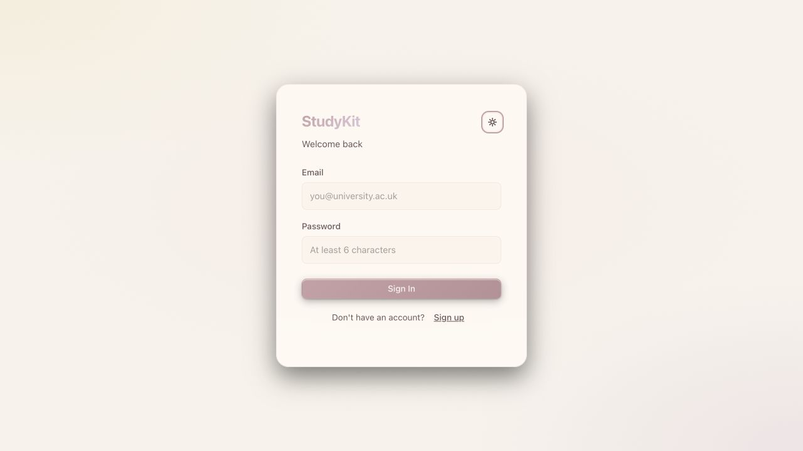
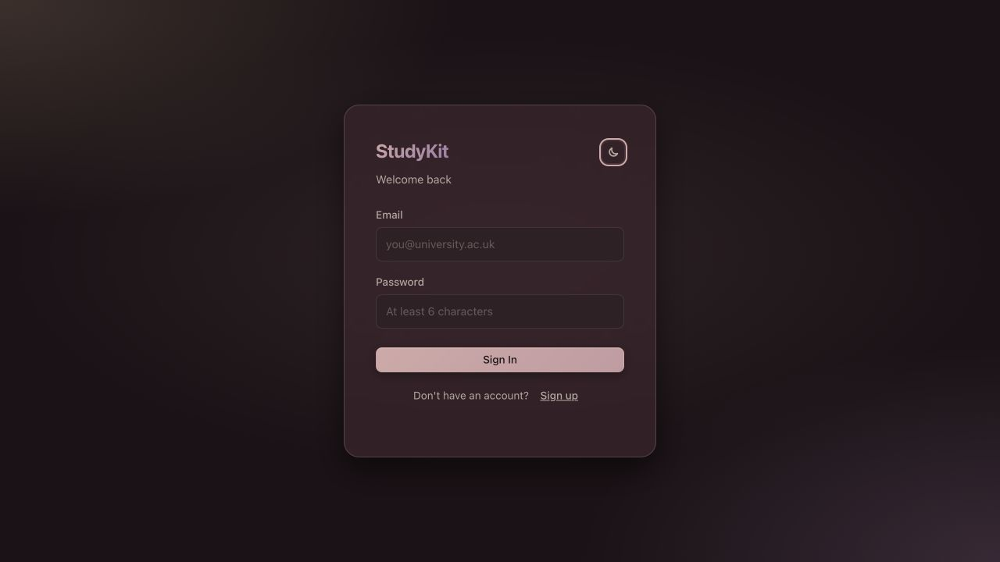

# WP-11 Alpha Entry Combined Audit

> Date: 2026-07-31  
> Scope: the currently reachable Web entry, checked at 1280×720 in Light and Dark.  
> Target: determine whether a participant can enter the intended local-first Alpha without prior product knowledge.

## Evidence

### Step 1 — Web entry, Light

Health: **Visually healthy, wrong Alpha entry.** The card is centered, readable, keyboard-semantic, and the theme control is clear. The only primary action is account sign-in, so it contradicts the product promise that a local workspace needs no account.

### Step 2 — Web entry, Dark

Health: **Visually healthy, same task blocker.** Surface separation and focus affordance remain clear. The pale primary button has usable visual prominence, but there is still no route to a local workspace or explanation that the Web rollout is not the Desktop Alpha.

## Strengths

- One calm primary task and low visual noise.
- Light/Dark switching preserves layout and hierarchy.
- Inputs have programmatic labels; buttons expose accessible names.

## UX risks

1. **P0 if this URL is sent to Alpha participants:** sign-in is a hard wall and invalidates local-first onboarding results.
2. The screen does not explain whether data is local, synced, or sent to AI.
3. “Sign up” can make a participant create an unnecessary account and contaminate the no-account task.

## Accessibility risks

- Screenshot and DOM evidence confirm labels and semantic buttons, but do not establish contrast ratios, 200/400% reflow, screen-reader announcements, or error recovery.
- The target Desktop workspace picker could not be inspected through the in-app browser; it must be covered by the manual device session.

## Decision

- The closed Alpha invitation must point only to the signed/controlled Desktop build and explicitly say not to use the Web URL.
- Web v0.4 rollout remains a separate release decision. Before any Web Alpha, enable the v0.4 local entry or add an honest “Desktop Alpha” route; do not test the legacy auth wall as if it were the new product.

## Evidence limits

This audit does not claim full WCAG compliance and does not audit the native folder picker, PDF reader, Canvas, or Research workflow. Those require the Desktop build and the manual protocol in `studykit_v0.4_wp11_alpha_test_kit_cn.md`.
