# StudyKit WP-11R0 产品收敛审计

日期：2026-07-31  
对象：已安装的 macOS StudyKit 0.4.0 当前构建  
范围：Workspace、全局 Shell、Study、Research、Library、Canvas、Evidence/Claim、Design、Quick Capture  
结论：**NO-GO for external Alpha。底层可恢复，但当前生产组合同时渲染 v0.4 路由与 v0.3 legacy body，导致两个产品系统叠在同一个窗口中。**

## 1. 总体判断

当前问题不是简单的视觉抛光，而是生产 composition root 没有完成收敛：

1. v0.4 `StudyRouter` / `ResearchRouter` 与 legacy `StudyKitAppContent` 同时渲染。
2. URL/location 与 legacy `sidebarMode` 同时控制界面，存在两个导航真相。
3. Study 的 Library/Canvas 能直接切到 Research legacy 表面，出现跨 Mode 串台。
4. 新 Research Project 与 legacy Literature Project 是两套上下文，所以同屏出现“已有研究项目”和“No literature projects yet”。

这解释了为什么单项 Gate 和自动化测试通过，但安装版仍呈现为多个模块拼接，而不是一个产品。

## 2. 逐步证据

### Step 1 — Study 首页：结构可运行，页面重复

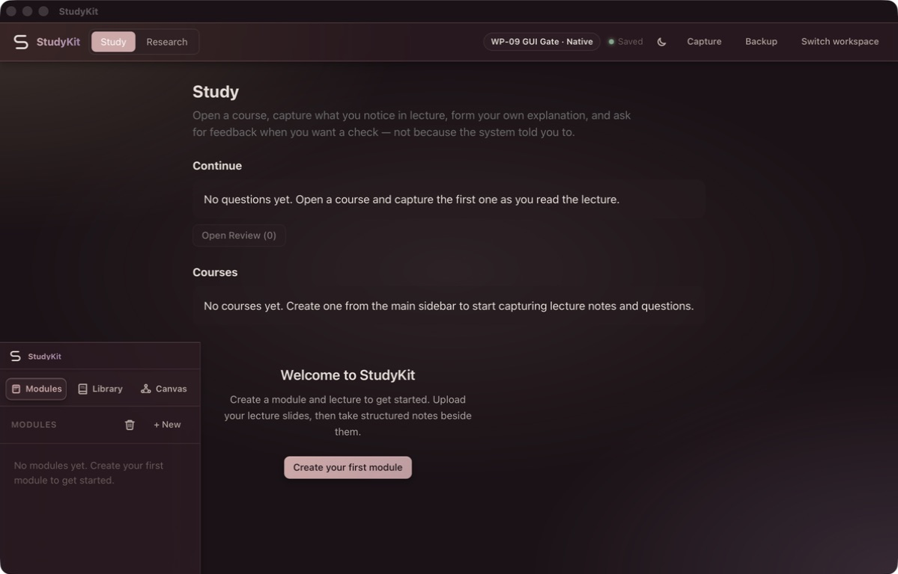

健康度：**P1，部分可用。** 顶部 Mode 和本地保存状态清楚，但同屏存在 v0.4 Study Home、legacy 左侧栏和第二个 Welcome 空状态，首要动作重复。

### Step 2 — Research 首页：两套项目系统同时出现

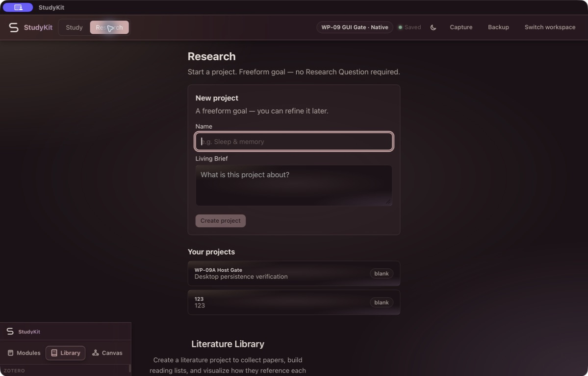

健康度：**P0。** 新 Research 项目列表与 legacy Literature Library/Project Sidebar 同屏。用户无法判断 Project 与 Literature Project 的关系。

### Step 3 — Research Project Home：功能齐全但没有任务主线

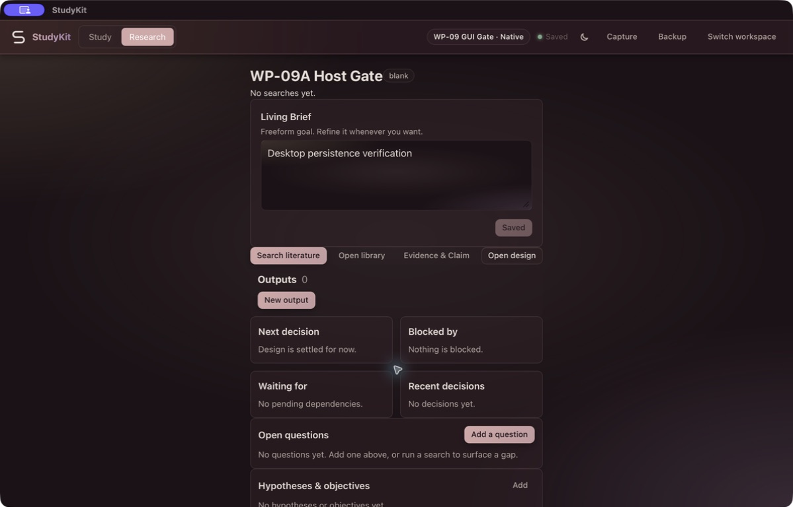

健康度：**P1。** Living Brief、Discovery、Library、Evidence、Design、Output、Question、Hypothesis、Risk、Milestone、Task 全部平铺；空项目首屏已经要求理解完整研究模型。

### Step 4 — Discovery：查询结构清楚，但仍被 legacy Library 包围

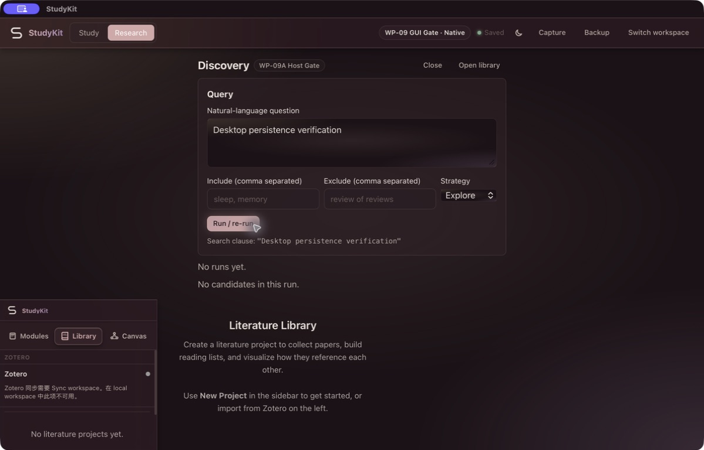

健康度：**P1。** 查询、include/exclude、strategy 可理解；但页面下方继续出现另一套 Literature Library，破坏任务焦点。

### Step 5 — Research Library：明显布局断裂

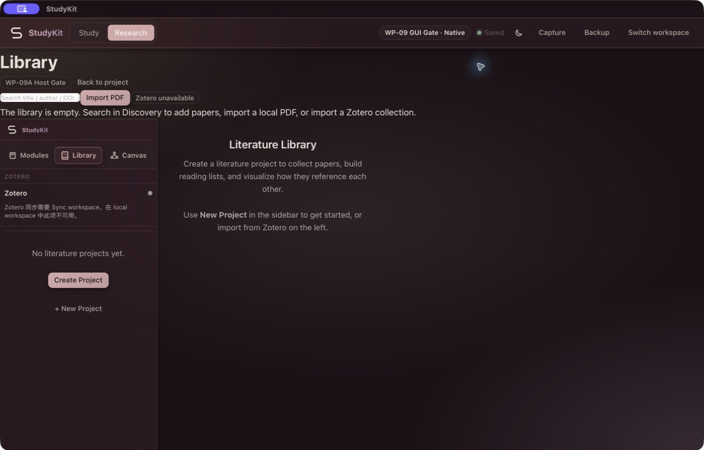

健康度：**P0。** 新 Library 标题和工具从窗口最左侧开始，legacy Sidebar 与空状态在其下方另起布局；页面没有形成单一内容区域。

### Step 6 — Research Canvas：路由与可见表面不一致

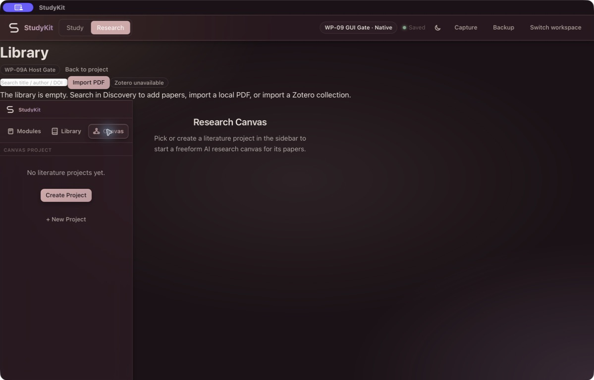

健康度：**P0。** 点击 Canvas 后 URL/上层仍是 Library，上层 Library 信息残留，可见内容则换成 legacy Research Canvas。

### Step 7 — Evidence & Claim：表单优先于证据任务

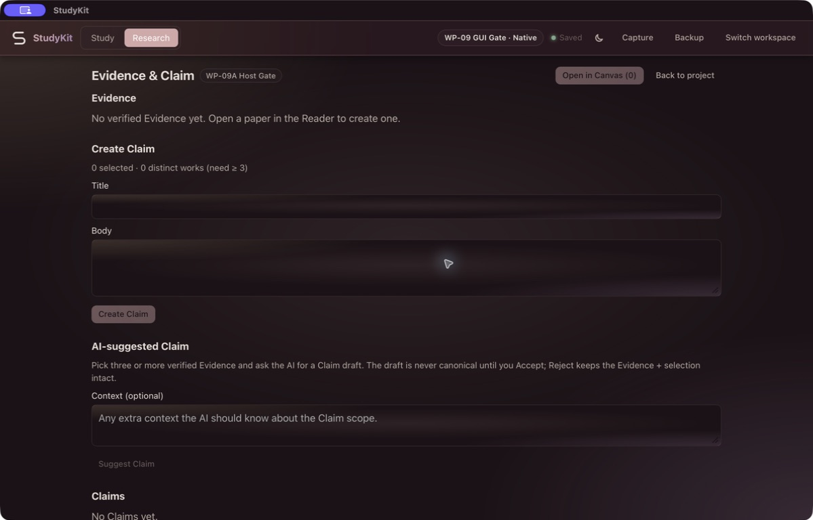

健康度：**P1。** Provenance 与 AI Draft 边界文案是优点；但无 Evidence 时仍展示大面积 Claim/AI 表单，空状态没有引导用户回到 Reader 创建第一条 Evidence。

### Step 8 — Design Workspace：单一动作清楚，但重复 Library 仍在

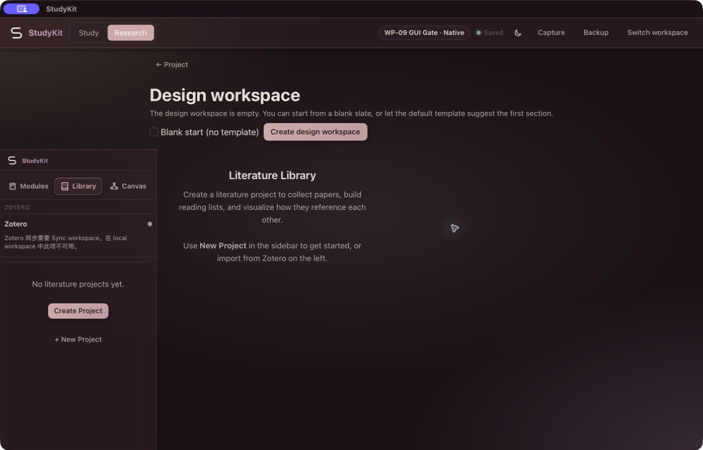

健康度：**P1。** Blank/template 选择简单；下方 legacy Literature Library 让用户误以为 Design 与 Library 同时是当前任务。

### Step 9 — Study Library：跨 Mode 串台

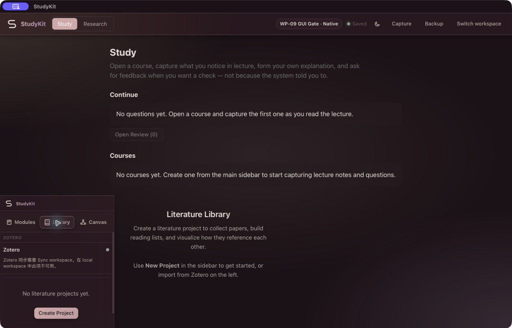

健康度：**P0。** Study Mode 内点击 Library，出现 Zotero 与 Research Literature Project。Study 语境没有自己的材料库定义。

### Step 10 — Study Canvas：直接显示 Research Canvas

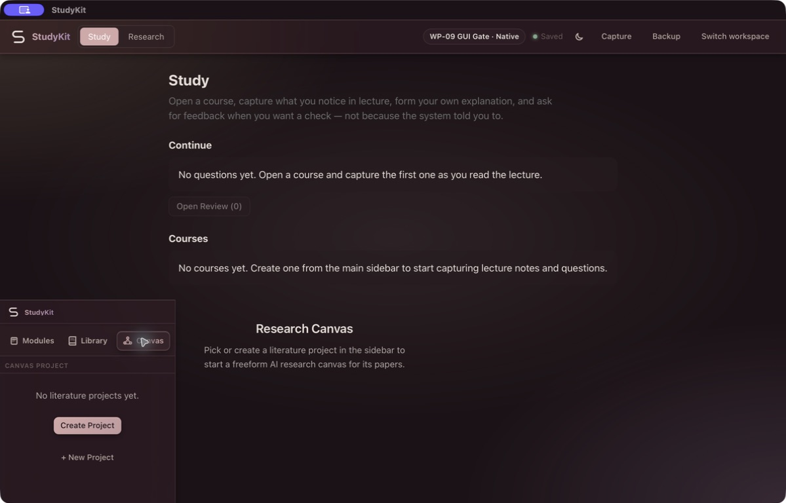

健康度：**P0。** Study Mode 内 Canvas 明确要求选择 literature project。这与双 Mode 产品模型冲突，也是当前最直接的用户可见架构错误。

### Step 11 — Quick Capture：概念正确，主题和归属仍需收敛

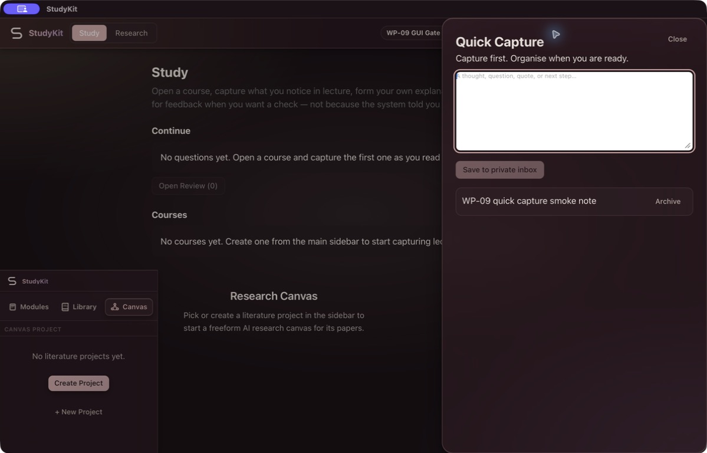

健康度：**P1。** “Capture first”符合低摩擦原则；但深色主题中出现纯白大输入框，且“private inbox”没有说明之后在 Study/Research 的何处找到。

### Step 12 — Workspace Chooser：当前最完整的产品表面

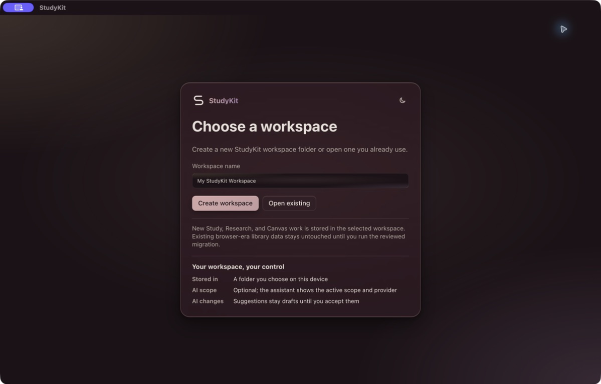

健康度：**健康，保留。** 本地目录、AI scope、AI draft 边界表达清楚；重启后能恢复上一次 Workspace。问题是 Switch Workspace 会立即离开当前上下文，缺少显式取消/返回和切换前说明。

## 3. P0 / P1 清单

| 级别 | 问题 | 决策 |
|---|---|---|
| P0 | v0.4 routers 与 legacy embedded body 同时生产渲染 | v0.4 路由成为唯一主内容；legacy 只能作为被适配的叶子组件，不得作为第二个 app body |
| P0 | URL/location 与 `sidebarMode` 两套导航真相 | 删除生产 Shell 对 `sidebarMode` 的导航依赖；所有导航只写 `AppLocation` |
| P0 | Study Library/Canvas 显示 Research 表面 | Mode 路由隔离；共享对象可以跨 Mode 引用，但表面不能串台 |
| P0 | Research Project 与 legacy Literature Project 双上下文 | 以 canonical Research Project 为唯一容器；legacy 文献数据通过 adapter/migration 进入该容器 |
| P0 | Library/Canvas 出现布局重叠和残留 | 建立唯一 Shell grid：header + contextual sidebar + active surface |
| P1 | Research Project Home 一次展示全部研究模型 | 改成“当前工作 + 最近内容 + 下一步”，其余进入二级表面 |
| P1 | 空 Evidence 时仍展示 Claim/AI 大表单 | 先显示创建 Evidence 的行动入口，满足前置条件后再展开 Claim |
| P1 | 内部 Gate/Test 数据暴露 | 移除 `WP-09 GUI Gate`、`WP-09A Host Gate`、`123`、`blank` 等工程痕迹 |
| P1 | Quick Capture 深色主题失配、归属不清 | 使用主题 token；保存后显示目标 Inbox 和可跳转位置 |
| P1 | Backup 无明显反馈 | 增加完成/失败状态和备份位置；避免无反馈点击 |

## 4. 保留 / 合并 / 退出生产组合

### 保留

- Native Workspace controller、SQLite repositories、重启恢复与备份能力。
- v0.4 Header、ModeSwitch 的视觉位置、Theme runtime、save status。
- `StudyRouter`、`ResearchRouter`、canonical Study/Research/Canvas/Output domain。
- Reader、PDF、annotation、citation、AI Draft 等已经验证的叶子能力。
- Quick Capture 的低摩擦概念。

### 合并

- legacy lecture reader/note editor 作为 Study Course 内部组件接入 `StudyRouter`。
- legacy PDF/Paper/annotation 组件作为 Research Library/Reader 内部组件接入 `ResearchRouter`。
- Cognitive Canvas 成为唯一 Canvas surface，通过 Mode/context 决定初始对象，不再保留 legacy LiteratureCanvas 顶层入口。
- 一个 contextual sidebar：Study 显示 Courses/Materials；Research 显示 Projects/Library；共享 Capture/AI 放全局层。

### 退出生产组合（不是立即删除数据）

- `V04Shell` 中的 `{props.children}` legacy app body。
- `V04EntryOrShell` 向 `V04Shell` 注入完整 `StudyKitAppContent mode="embedded"` 的方式。
- `ModeSwitch` 和 `SidebarContent` 直接写 `sidebarMode` 的生产导航。
- legacy 顶层 Modules/Library/Canvas 三按钮作为第二套路由。
- 面向用户的所有 WP/Gate/test 标签。

## 5. 根因对应代码

- `frontend/src/app/v04/V04Shell.tsx:470` 同时挂载 `StudyRouter`、`ResearchRouter`，并在 `:474` 继续渲染 `props.children`。
- `frontend/src/App.tsx:228` 把完整 legacy `StudyKitAppContent mode="embedded"` 注入新 Shell。
- `frontend/src/app/v04/V04Shell.tsx:315` 用 effect 在 URL 与 legacy `sidebarMode` 之间做双向式同步。
- `frontend/src/app/v04/ModeSwitch.tsx:43` 同时写 legacy store 和新 location。
- `frontend/src/components/SidebarContent.tsx:398` 的 Modules/Library/Canvas 只写 legacy `sidebarMode`，因此 URL 与可见表面分离。
- `frontend/src/App.tsx:550` 的 legacy body 把 Canvas 永久定义为 Research Literature Canvas，直接造成 Study Canvas 串台。

## 6. WP-11R1 施工边界与 Gate

本轮修复不是重写功能，而是替换生产 composition：

1. 先让 v0.4 Router 成为唯一可见主内容。
2. 建立新的 Mode-aware sidebar，只通过 `locationStore` 导航。
3. 逐个把 legacy 叶子能力接入对应 v0.4 surface。
4. 保留 legacy 数据和 migration，不在收敛包中删除用户数据。
5. 加生产组合测试，明确断言一个时刻只存在一个 H1、一个主内容、一个 sidebar、一个 active surface。

Gate：

- Study 页面不得出现 Research Canvas、Zotero 或 Literature Project 创建入口。
- Research 子页面不得同时出现 legacy Literature Library 空状态。
- URL、选中导航和可见 surface 三者完全一致。
- 1280×820 下主任务首屏不被第二套页面挤压。
- Workspace 重启恢复、SQLite、Study/Research repository、Light/Dark 不回归。

## 7. 证据边界

本次没有创建或删除用户内容，也没有运行真实文献搜索、导入 PDF、生成 AI 内容、创建 Output 或启动协作，因此这些任务的完成率仍待后续 seeded workspace 测试。截图和可访问性树可以证明结构、标签、焦点与可见布局问题，但不能替代对比度测量、缩放、VoiceOver、键盘全流程和低端设备性能测试。
