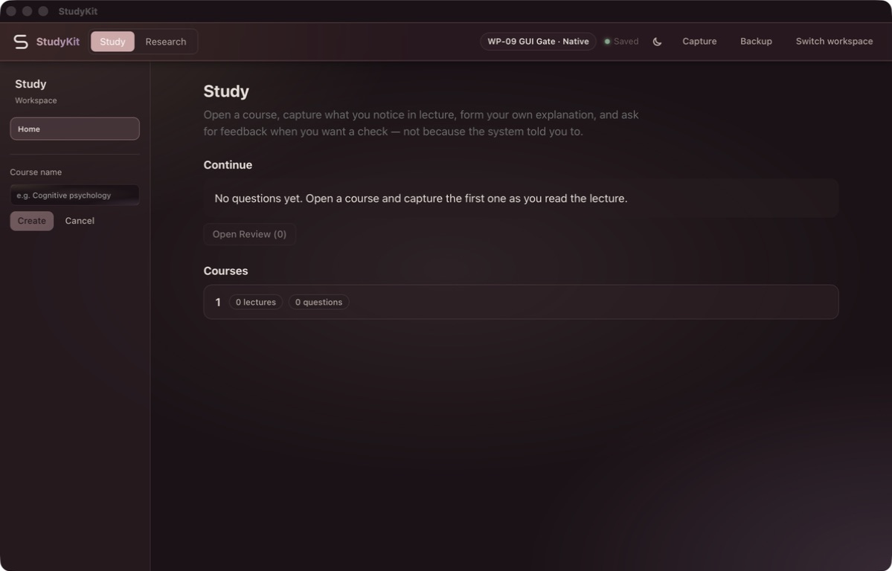
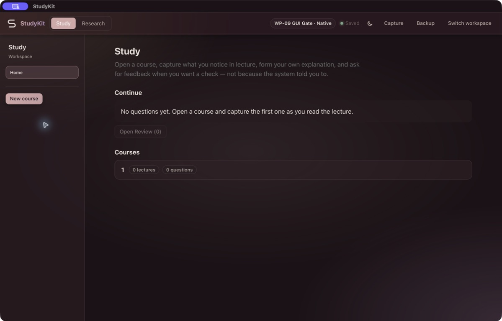
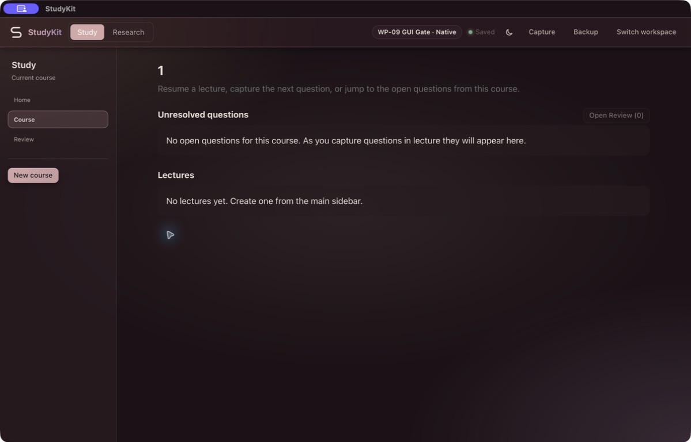
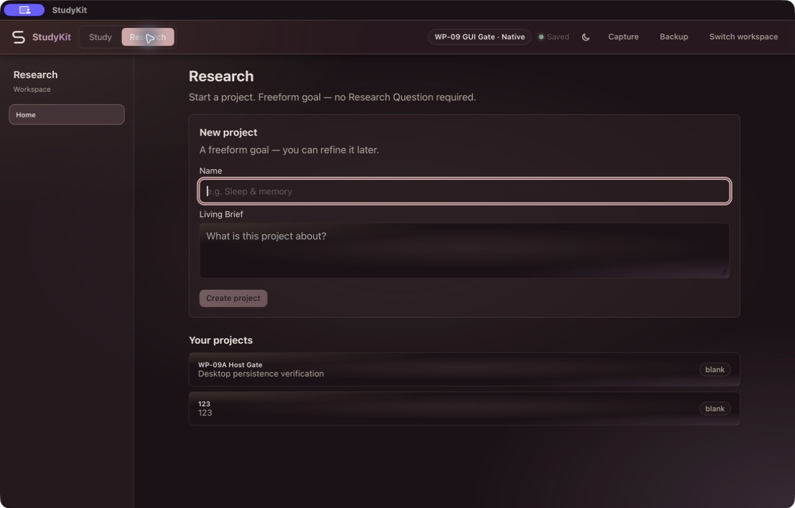
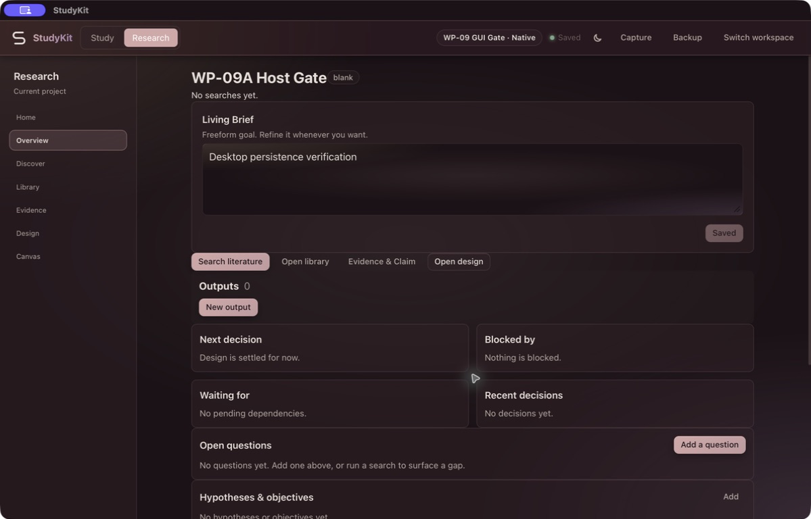
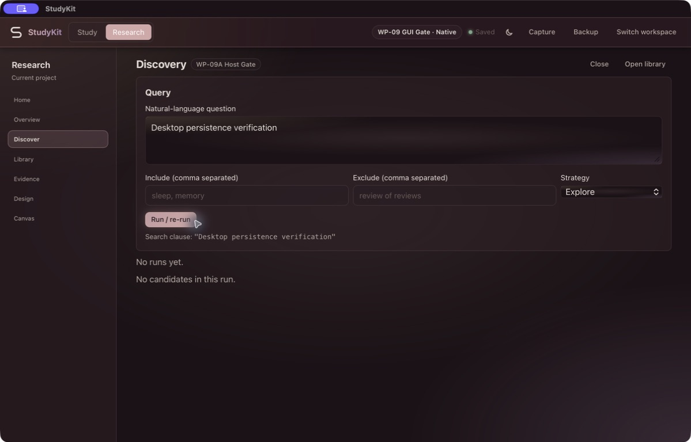
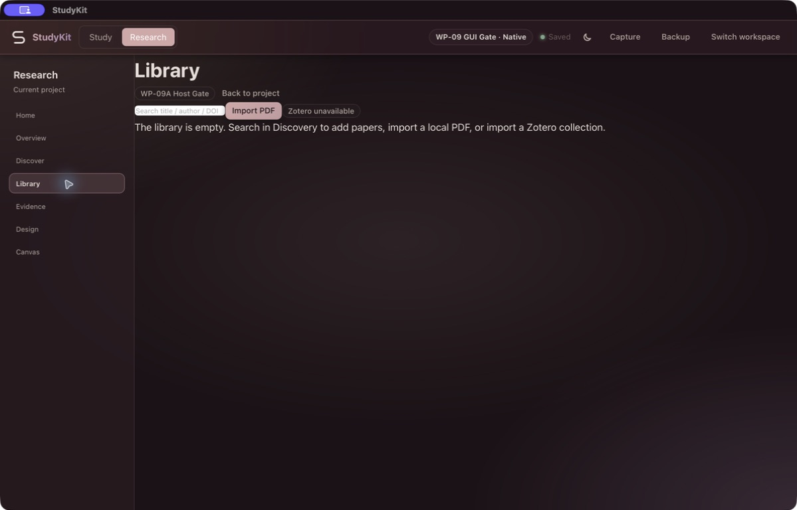
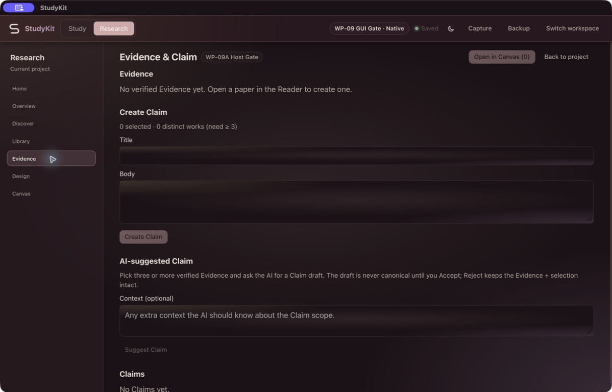
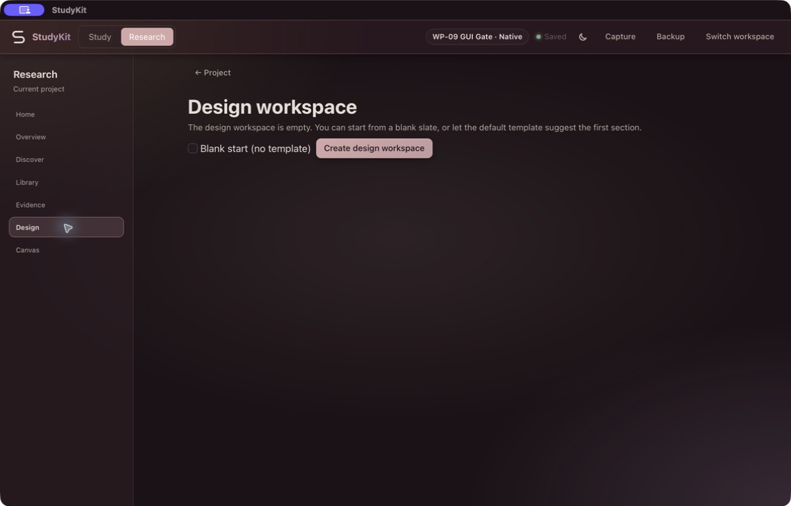
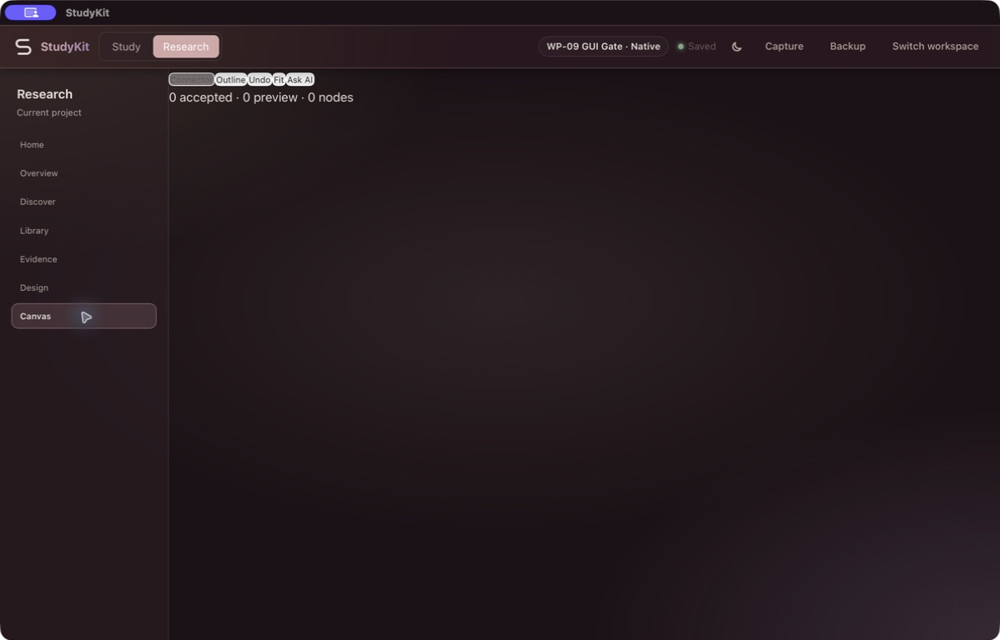

# StudyKit WP-11R2 核心操作逻辑审计

日期：2026-07-31  
对象：已安装的 `/Applications/StudyKit.app`  
模式：UX + 可访问性风险联合审计  
用户目标：不学习软件内部结构，也能自然完成“进入上下文 → 添加材料 → 思考/连接 → 形成结果 → 回到下一步”。

## 总体判断

当前版本已经从“双应用叠加”收敛成一个壳，但内部仍是**功能目录式产品**，不是**连续思考式工作台**。页面按数据类型拆成 Course、Library、Evidence、Design、Canvas，用户必须预先知道每个概念、先后关系和内容归宿；状态不足时又展示大量禁用表单或空白画布。结果是导航看似清楚，实际任务频繁中断。

这不是视觉微调能解决的问题。WP-11R2 应先重构操作模型，再替换页面。

## 真实流程与健康度

### Step 1 — Study Home / 新建课程：勉强可用

- 优点：新建课程入口可见，表单字段少。
- 问题：表单挤入导航栏，改变侧栏结构；创建行为和课程列表相隔很远，用户无法预判创建后去哪里。
- 风险：主导航、对象创建和上下文动作混在同一层级。

### Step 2 — Study Home / 继续学习：弱

- “Continue”在没有 Question 时完全失效，但没有显示最近课程、最近 Lecture 或导入材料等更常见的继续入口。
- 课程卡只显示数量，缺少“上次做到哪里”和直接动作。
- 页面文案讲理念，行动信息不足。

### Step 3 — Course Home / 创建 Lecture：阻断

- 页面提示“Create one from the main sidebar”，但侧栏只有 `New course`，没有创建 Lecture。
- 用户进入课程后没有可完成的首要动作，形成真实死胡同。
- `Review` 在没有 Question 时仍占据永久导航位置，加重无效选择。

### Step 4 — Research Home / 项目入口：可用但主次倒置

- 创建项目表单始终占据首屏最大面积；高频“继续已有项目”反而被压到下方。
- 页面自动聚焦输入框，视觉上暗示“每次进入都应该新建”，不符合回访用户任务。
- 项目卡没有最近活动、下一步、未完成事项或协作状态。

### Step 5 — Project Home / 项目总览：严重过载

- 同时暴露 Search、Library、Evidence、Design、Output、Question、Hypothesis、Risk、Milestone、Task、Decision 等大量概念。
- 所有区块看起来权重相近，用户无法判断当前应该做什么。
- “Next decision / Blocked by / Waiting for”在空项目中占据大量空间，却没有推动用户开始研究。
- 这是数据库字段仪表盘，不是研究者的思考现场。

### Step 6 — Discovery / 搜索：局部可用，衔接较弱

- Living Brief 自动进入自然语言查询，是当前少数自然衔接。
- `Run / re-run`、`Close`、`Open library`均是系统术语；没有解释结果如何筛选、保存、进入阅读和回到研究问题。
- Include / Exclude / Strategy 在第一次搜索时全部展开，增加初学成本，应该作为可选 refine 控件。

### Step 7 — Library / 空库：弱

- 空状态把 Discovery、PDF、Zotero 三种来源写成一句话，但只有 Import PDF 是直接动作。
- Search 输入在空库中没有意义；页面没有统一的 `Add sources` 入口。
- 大面积空白和小尺寸控件让首要动作不明确。

### Step 8 — Evidence & Claim：错误的渐进顺序

- 没有 Evidence 时仍完整展示 Claim 表单和 AI Claim 表单；用户看到的是大量不可执行控件。
- 系统要求至少三篇来源，却没有从此处直接“去添加/阅读/标记 Evidence”的主动作。
- Evidence、Claim 和 Canvas 被分成页面及按钮跳转，削弱从原文到综合判断的空间连续性。

### Step 9 — Design：弱且带流程暗示

- 用户先被要求“创建 design workspace”，这是系统内部对象，不是自然研究行为。
- “Blank start / default template”把自由度包装成初始化选择；应允许直接写问题、假设、方法或拖入现有材料。
- 画面没有带入 Living Brief、Evidence、Question 等现有上下文。

### Step 10 — Canvas：阻断

- 空画布没有明显的新建卡片、粘贴、拖入、模板或自由书写入口。
- Connector 在无选择时禁用，AI 只以工具栏小按钮存在；用户进入后几乎不知道如何开始。
- 作为产品核心承诺的“符合头脑风暴规律的画布”，当前只是空的渲染容器。

## 结构性根因

1. **以实体类型组织，而不是以用户意图组织。** Library、Evidence、Claim、Design、Task、Output 是内部模型，不应都成为一级目的地。
2. **导航承担了工作流。** 用户被迫靠跳页面推进研究，内容之间缺少直接操作和空间连续性。
3. **没有稳定的通用动作语言。** Create、Add、Import、Run、Open、Capture、Suggest 分散存在；同一行为在不同页面名称和位置都不同。
4. **前置条件通过禁用控件表达。** 产品告诉用户“现在不能做”，却不提供最短的可执行下一步。
5. **AI 不是操作系统级能力。** 普通页面没有稳定入口、选区动作或上下文提示；Canvas 才出现 Ask AI。
6. **Canvas 与内容系统割裂。** 它不是默认思考空间，也无法自然接住 Paper、Evidence、Question、Hypothesis 和 Task。

## WP-11R2 操作模型决策

### 1. 固定四层界面

- **全局层**：Study / Research、全局搜索、Capture、AI、同步与工作区。
- **上下文层**：当前 Course 或 Project；左栏主要用于切换上下文，不罗列数据库模块。
- **工作层**：一块连续工作区，支持文档/列表/画布按需切换，而不是每类对象一个孤立页面。
- **检查层**：右侧 Inspector / AI，显示当前选择的来源、关系、属性、建议与历史；不抢占主任务。

### 2. 统一五个用户动作

`Add`（材料/想法）→ `Capture`（问题/证据）→ `Connect`（关系/画布）→ `Develop`（解释/设计/输出）→ `Share`（协作/导出）。

这些是操作，不是强制步骤；任何阶段都可跳转，保持用户自由。

### 3. Study 主路径

`Course → New/Open Lecture → Add source or blank notes → Read/annotate/capture question in one workspace → optional AI feedback → Review when wanted`

- Course 空状态直接提供 `New lecture`、`Import slides/PDF`、`Start blank notes`。
- Lecture 使用三栏：source / thinking canvas + notes / contextual AI inspector。
- Question 是选区或光标旁的轻量 Capture 动作，不跳离 Lecture。

### 4. Research 主路径

`Project → Add sources or start with a question → read/select/capture Evidence → arrange and connect on canvas → develop Claim/design/task/output in place`

- Project Home 首屏只显示：最近上下文、一个可编辑 Focus、继续工作、统一 `Add`、下一项用户自定动作。
- Library/Discovery 合并为 Sources；搜索、PDF、Zotero 是同一个 Add Sources 面板的来源选项。
- Evidence/Claim 不再作为空项目中的独立表单页；从 Reader 选区、Source card 或 Canvas selection 就地创建。
- Design、Task、Output 是选中内容的 `Develop into…`，不是预先必须创建的工作区。

### 5. AI-native 行为

- 全局 `Ask` 入口始终存在，支持快捷键；默认理解当前 Course/Project/selection。
- 选中文字、节点、Evidence 或多张卡片后显示轻量 contextual actions。
- AI 结果先以可编辑 Draft 放在当前工作区旁，不强制跳页，不自动写 canonical。
- AI 可以解释、比较、发散、整理、反驳和转化，但不决定用户研究流程。

## P0 实施顺序

1. 修复 Course 死胡同：新增 Lecture / Import / Blank notes，移除错误空状态文案。
2. 建立统一 `Add` 与全局 `Ask AI`；所有 surface 可见且上下文一致。
3. 重做空 Canvas 的开始体验：点击、双击、粘贴、拖入、快捷添加均可开始。
4. Project Home 降噪，只保留 Focus、Continue、Add、Next；其余进入按需展开。
5. 合并 Discovery + Library 为 Sources；Evidence 从 Reader/Canvas 就地捕捉。
6. 将 Design / Task / Output 变为 `Develop into…`，保留直接访问但不要求按流程使用。

## 可访问性风险与证据边界

- 可见风险：大量浅灰文字和禁用按钮在 Dark 下对比偏低；工具栏目标较小；空 Canvas 缺少键盘可发现的首动作；表单自动聚焦可能扰乱阅读顺序。
- AX 树确认主要按钮和字段有名称，但截图与只读树不能证明完整键盘顺序、焦点可见性、VoiceOver 语义、缩放重排或 WCAG 合规。
- 下一轮实现必须补键盘主路径、焦点返回、状态播报和真实 VoiceOver 检查。
