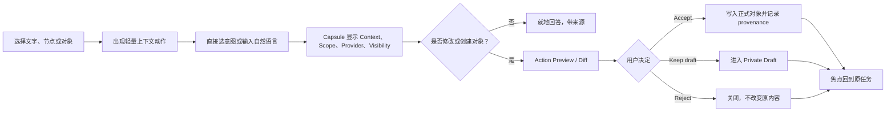
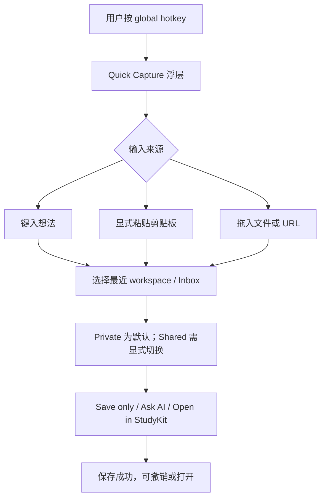
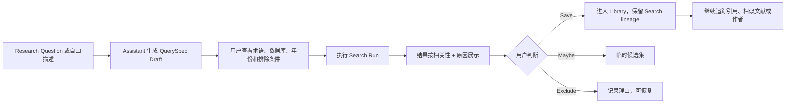
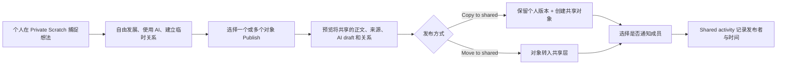

# StudyKit v0.4 交互流程规范

> 版本：0.4.0-draft  
> 日期：2026-07-19  
> 适用范围：Web、Desktop、Study Mode、Research Mode、系统级 AI Assistant、Research Collaboration  
> 目标：把 v0.4 的产品原则转化为可原型、可测试、可实现的端到端交互流程。

---

## 0. 核心结论

StudyKit 不应让用户学习一套复杂的软件流程。所有表面复用六个动作：

```text
进入上下文 → 捕捉/选择 → 连接/召唤 → 预览 → 接受/保留草稿 → 恢复工作
```

这套语法同时服务：

- 学生在 lecture 中快速记录、理解与复习；
- 研究人员从搜索、阅读、Evidence、Claim 走到研究设计与输出；
- 用户在任何页面随时召唤 AI Assistant；
- 团队在保留个人思考空间的同时共同编辑、评论与决策；
- Desktop 用户离开主窗口后仍能快速捕捉材料与想法。

产品自由度来自“入口开放、结构渐进、视图可换”；产品易用性来自“动作一致、状态可见、随时可撤销”。

## 1. 全局交互原则

### 1.1 不强制起点

用户可以从以下任一位置开始：

- 空白 Canvas；
- Quick Note；
- PDF / slides /网页或文件；
- Search；
- Course / Research Project Home；
- Desktop Quick Capture；
- 团队 mention 或 review request。

系统不得要求用户先选择模板、对象类型、研究方法或 AI 模式。模板和结构均为可选支架。

### 1.2 Focus 决定上下文，Selection 决定范围

- **Focus**：用户当前正在工作的 Course、Project、Source、View 或对象；
- **Selection**：本次动作明确选中的文字、区域、节点、行或对象集合；
- **Pinned Context**：用户主动固定、允许跨视图保留的资料；
- **Scope**：Selection → Current view → Container → Explicit set，默认采用最小范围。

普通 selection 在切换 View 或 Container 后释放；Pinned Context 保留并始终显示。跨 Course / Project 扩大范围必须显式操作。

### 1.3 所有生成先进入 Draft

AI、自动抽取、批量变换和协作建议都不能直接覆盖 canonical content：

```text
Suggestion → Preview → Draft → Accept / Edit / Reject → Canonical object
```

短动作在原位置预览；复杂结果进入临时 workspace；后台任务进入 Runs。三者都必须能回到发起对象。

### 1.4 自由内容可以延后结构化

- 双击 Canvas、粘贴文本或手写即可产生自由节点；
- 系统不立即要求类型；
- 当用户搜索、比较、引用、复习或共享时，再建议提升为 Question、Claim、Evidence、Task 等对象；
- 用户可以选择“稍后”“保持自由”；
- 升级对象不得改变原位置、正文或创建时间。

### 1.5 同一对象，多种视图

Canvas、Document、Table、Timeline、Review 与 Output 只是同一对象的不同呈现。切换视图不复制内容，也不打断用户当前选区与历史。

## 2. 应用 Shell 与导航模型

### 2.1 三层导航

| 层级 | 内容 | 交互要求 |
|---|---|---|
| Workspace | Local / Sync workspace、全局搜索、Inbox、设置 | 稳定、低频、始终可返回 |
| Mode | Study / Research | 是工作语境切换，不是数据孤岛 |
| Container | Course / Research Project | 记录目标、成员、最近位置与视图 |

进入一个 Container 后，默认恢复用户上次工作位置，而不是总回首页。Project Home / Course Home 通过固定入口可随时返回。

### 2.2 全局可达能力

无论在哪个 View，用户都能在一次操作内访问：

- Universal Intent Capsule；
- Global Search；
- Inbox / Quick Capture；
- Back / Forward；
- 当前同步、离线和 AI provider 状态；
- 最近一次可撤销动作。

### 2.3 Mode 切换

切换 Study / Research 时：

1. 当前编辑自动保存到本地；
2. 未提交 AI 结果保留为 Private Draft；
3. 普通 selection 释放，Pinned Context 保留并显示来源 Mode；
4. 目标 Mode 恢复最近 Container 与位置；
5. 用户可将当前对象作为引用带入目标 Mode，而不是复制一份。

## 3. 系统级 AI Assistant

### 3.1 Invocation Matrix

| 入口 | 当前上下文 | Assistant 出现位置 | 默认行为 |
|---|---|---|---|
| 选中文字/PDF 区域 | selection + source locator | 选区附近 | Explain / Question / Evidence / Cite |
| 选择 Canvas 对象 | object IDs + relations | 对象附近 | Connect / Challenge / Compare / Transform |
| 表格行或单元格 | row/cell + schema | 行内或表格边缘 | Extract / Check / Fill draft / Compare |
| 无选择时应用内快捷键 | current view + goal | 居中 transient Capsule | Search / Create / Navigate / Ask |
| Desktop global hotkey | clipboard only on explicit action | 系统级小浮层 | Quick Capture / Ask / Send to workspace |
| Transition suggestion | completed event | 非阻断轻提示 | 建议一个可忽略的下一动作 |

所有入口打开同一个 Assistant session model，不分别维护页面聊天记录。

### 3.2 Flow A：在对象旁召唤



交互细节：

- 首层最多显示 3–4 个与 selection 匹配的动作；
- 用户继续输入时，Capsule 自动收起为图标，不遮挡正文；
- `Esc` 关闭但保留已输入 prompt；
- 结果较短时贴近对象展开；超过一屏或涉及多个对象时进入临时 AI workspace；
- 关闭临时 workspace 后回到原对象和原缩放位置。

### 3.3 Flow B：无选择时随时召唤

1. 用户按应用内快捷键；
2. Capsule 显示当前 Container、View 与最近目标，不默认读取全部资料；
3. 用户输入“找出项目里关于睡眠波动的反例”；
4. Assistant 先显示建议 scope，例如 `Current project · Verified Evidence`；
5. 用户可添加/移除 context chips；
6. Assistant 执行 search 或启动后台 Run；
7. 结果以可操作对象返回：打开、固定、加入 Canvas、创建 Task 或形成 Draft Claim；
8. 用户关闭 Capsule 后搜索结果仍可从 History / Run 回到。

### 3.4 Flow C：Desktop Quick Capture



约束：

- 不后台持续监听剪贴板；只有用户选择 Paste / Use clipboard 才读取；
- 默认进入 Private Inbox；
- Shared project 发布需要显示项目与可见成员；
- 离线时正常保存，显示 `Saved locally`；
- 重复 URL / file 只提示可能重复，不阻断捕捉；
- global hotkey 冲突时提供检测和重新绑定。

### 3.5 Flow D：复杂后台任务

适用于 literature search、OCR、批量 extraction、synthesis、citation audit：

1. Assistant 先展示任务计划、scope、provider 和预计成本/耗时；
2. 用户启动后 Capsule 可关闭；
3. Run 出现在非阻断状态区；
4. 用户可 Pause、Cancel、Change scope 或继续本地工作；
5. Partial results 按批次进入 Draft，不等全部完成；
6. 失败项可单独重试；
7. Run 完成后只提示结果与待审核数量，不自动提交正式对象。

## 4. Study Mode 端到端流程

### 4.1 Flow S0：首次启动与本地 Workspace

1. 用户选择 `Local workspace` 或 `Sync workspace`；默认突出本地选项，但不贬低同步；
2. 选择资料位置与可选备份位置；
3. AI 单独选择 `No AI / Local AI / Cloud AI`；
4. 用户可以跳过 Course 创建，直接 Quick Note、导入文件或打开空白 Canvas；
5. 当内容开始聚集时，系统再建议创建 Course；
6. Onboarding 完成后所有设置可修改，不锁定路径。

成功标准：首次捕捉内容不超过 60 秒；不注册也能开始。

### 4.2 Flow S1：Lecture 中捕捉理解

| 步骤 | 用户行为 | 系统响应 | AI 姿态 |
|---|---|---|---|
| 1 | 打开 Lecture，导入 slides | 恢复最近页与笔记光标 | 后台索引，安静显示状态 |
| 2 | 课堂输入自由笔记 | 自动关联当前页和时间段 | 不在连续输入时弹出 |
| 3 | 框选 slide 段落 | 出现 Explain / Question / Link / Capture | 只读取选区及相邻上下文 |
| 4 | 选择 Explain | 就地展开简短解释与来源 | 用户可继续问、保存或关闭 |
| 5 | 保存为 Note / Question | 创建 Draft，保留 locator | 不自动重写用户笔记 |
| 6 | 切换页面或结束 lecture | 保存位置并显示未解决问题 | 最多一条可忽略建议 |

### 4.3 Flow S2：从材料到理解

1. 用户打开 PDF / textbook / recording transcript；
2. Reader 保持正文为主，不默认打开 AI panel；
3. 用户高亮、写旁注或把段落拖到自由笔记；
4. Assistant 可解释、举例、质疑、生成替代表述或检查用户理解；
5. 用户把结果保存为 Note、Question 或 Concept；
6. 新对象可在 Document、Canvas 或 Review 中继续使用；
7. 回到 Reader 时定位到原页和选区。

### 4.4 Flow S3：复习而不被“老师式管理”

1. 用户从 Course Home、Search 或任一对象选择 `Review`；
2. 系统显示可选范围与模式：Recall、Explain、Practice、Browse；
3. 用户可以作答后反馈，也可以直接 Reveal；
4. AI 反馈区分来源事实、用户表达和模型建议；
5. 用户决定是否更新 Note、创建 Question 或加入下一次复习；
6. 退出后回到发起对象，不用完成规定数量。

系统可以显示进度，但不得使用惩罚性 streak、失败评价或阻断内容访问。

### 4.5 Flow S4：自由头脑风暴到结构

1. 用户打开空白 Study Canvas；
2. 双击、手写、粘贴或拖入资料即可形成自由节点；
3. 用户通过空间位置和自由连线发散；
4. Assistant 只在召唤后建议聚类、反例、问题或关系；
5. 用户预览布局变化，可逐项接受或全部撤销；
6. 需要复习/搜索时，再将部分节点提升为 Concept、Question 或 Note；
7. Canvas 与 Outline 共享对象，用户可随时换视图。

## 5. Research Mode 端到端流程

### 5.1 Flow R0：创建或恢复 Research Project

新项目：

1. 用户选择 `Blank`, `Explore`, `Review`, `Empirical Study` 或导入现有资料；
2. 模板只是建议视图，不锁定流程；
3. Research Question 可以空缺或是自由文本；
4. Project 创建后直接进入 Project Home；
5. 首屏只突出当前问题、最近证据/想法和一个主要动作。

已有项目：

1. Project Home 恢复上次工作位置和当前研究状态；
2. 显示 `Question → Evidence → Claim → Decision → Output` 中已经存在的对象和断点；
3. 团队项目显示最近 mentions、待 review 和协作者 presence；
4. 用户选择 `Resume` 回到精确 View、selection 和 zoom；
5. AI 可提示一个缺口，但不替用户决定优先级。

### 5.2 Flow R1：AI-native Literature Discovery



关键交互：

- Query Builder 提供自然语言和结构化条件的双向编辑；
- 用户修改条件后立即看见结果变化原因；
- AI 推荐必须显示 `why this paper`，不只给相关性分数；
- 保存文献时同时保存 provider、query、rank 和 inclusion reason；
- Search Run 是可复现对象，可复制、比较和重跑。

### 5.3 Flow R2：Library → Reader → Evidence

1. 用户从 Library 打开论文，Reader 恢复上次页码；
2. 选中 passage 后出现 `Evidence / Note / Question / Cite / Ask`；
3. 选择 Evidence 后显示最小表单：excerpt、locator、关联 Research Question；
4. AI 可建议 interpretation、construct、method 或 limitation，但放在 candidate fields；
5. 用户核对 passage 后接受、编辑或保持自由笔记；
6. 正式 Evidence 保存后，在 Reader、Evidence Table、Canvas 和 Output 中是同一对象；
7. 返回 Library 时阅读状态和未解决问题自动更新。

没有 locator 的内容只能保存为 Note 或 Evidence Draft，不能成为 verified Evidence。

### 5.4 Flow R3：Evidence → Claim → Synthesis Canvas

1. 用户在 Evidence Table 选择若干行，或从 Project Home 打开未解决问题；
2. 选择 `Open in Canvas`，系统保持对象 ID 和筛选范围；
3. Evidence 以可展开节点出现，默认不自动排成知识图谱；
4. 用户自由移动、分组和连接；
5. Assistant 可执行 Compare、Cluster、Find contradiction、Suggest claim；
6. 所有 AI relation / Claim 先显示为可区分 Draft；
7. 用户接受 Claim 时必须选择 supporting / opposing Evidence；
8. Canvas 右侧或 Focus View 显示 Claim 的 evidence coverage 与未解决冲突；
9. 用户关闭 Canvas 后回到原 Table selection 或 Project Home。

### 5.5 Flow R4：Research Design

1. 用户从 Research Question、Claim 或 Project Home 创建 Design Draft；
2. 选择空白开始或启用学科模板；
3. Design Workspace 只展示当前需要的 section；
4. Method Assistant 检查 Question、construct、sample、measure、analysis 之间的一致性；
5. 每条建议链接到 Evidence、guideline 或明确标记为通用建议；
6. 用户接受后形成 Design Decision，并记录 alternatives 与 rationale；
7. Decision 可以生成依赖 Task，但不会自动分配成员或日期；
8. 修改上游 Design Decision 时，系统提示受影响任务和输出，不自动重写。

### 5.6 Flow R5：Research-native Project Management

1. Project Home 从研究对象推导 `Next decisions / Blocked by / Waiting for review`；
2. 用户可以把 Question、Evidence gap、Design Decision 或 Output section 转为 Task；
3. Task 保留来源对象和完成定义；
4. Timeline 只显示研究依赖、milestone 和责任人，不做资源利用率仪表盘；
5. Assistant 可建议依赖和遗漏，但不得自动改变优先级、负责人或 deadline；
6. 完成 Task 时要求关联产出或决策，避免“任务完成但研究状态没变”；
7. Project Home 更新 research lineage，而不只更新百分比。

### 5.7 Flow R6：Output 与 Citation

1. 用户从 Claim / Design / Project Home 创建 Outline；
2. 将 Claim、Evidence 或自由笔记拖入 section，形成写作上下文；
3. Assistant 可生成段落 Draft，但必须显示 supporting objects；
4. 插入引用时调用 Citation Picker，只能选择 canonical Work；
5. Citation Auditor 检查 identity、metadata、locator 和 statement support；
6. 不能确认的引用显示 `citation needed`，不生成虚假 reference；
7. 用户接受段落后，AI provenance 不污染最终导出样式，但保留在内部 history；
8. 导出前显示阻断性 integrity errors 与非阻断 warnings。

## 6. Research Collaboration

### 6.1 Flow C0：邀请与权限

1. Owner 打开 Project members；
2. 输入邮箱或生成受限邀请链接；
3. 选择 Editor、Commenter 或 Viewer；
4. 系统用一句话预览权限，而不是只显示角色名；
5. 邀请发出后进入 Pending，可撤销；
6. 新成员首次进入时看到项目问题、自己的权限和可见范围；
7. 权限变化立即影响新操作，已有离线更改在同步前进入 review queue。

### 6.2 Flow C1：Private Scratch → Shared



默认使用 Copy to shared，避免过早破坏个人思考空间。

### 6.3 Flow C2：实时共创

- Presence 只显示当前 View 内的成员，不制造全项目在线压力；
- 远程光标和 selection 使用低饱和个人色；
- 同一节点被他人编辑时显示 soft lock / live state，但不阻断阅读和评论；
- 用户可以进入 Follow mode，主动跟随某位协作者；
- AI Draft 只对发起者可见，直到选择 Publish；
- 发布 AI Draft 时显示生成者、scope 和目标对象；
- 实时状态不写入正式 history，正式内容变化写入 activity / version history。

### 6.4 Flow C3：异步 Review 与 Decision

1. Editor 在 Claim、Design Decision、Outline section 或 Canvas scene 上请求 Review；
2. 选择 reviewers、问题与期望时间；
3. Reviewer 从通知进入精确对象与上下文；
4. 评论锚定对象/selection，可 Suggest change 或 Ask question；
5. 作者逐条 Resolve、Accept 或 Convert to task；
6. 关键讨论可以 `Record decision`，形成 rationale 与 alternatives；
7. 完成 Review 后 Project Home 更新等待项，不自动把争议标为解决。

### 6.5 Flow C4：离线与冲突

1. 离线编辑继续写入本地 operation log；
2. UI 显示 `Local changes`，不阻断工作；
3. 重连后无冲突更改静默合并；
4. Canvas / collaborative text 通过 CRDT 合并；
5. 权限撤回、删除或语义冲突进入 Conflict Review；
6. 用户比较 Local / Shared / Combined，不用处理原始数据结构；
7. 无论选择哪一版，都保留另一版到 history，避免数据丢失。

## 7. 跨 Mode 流程

### 7.1 Study → Research

1. 用户在 Course Note、Question 或 Source 上选择 `Use in Research`；
2. 选择已有 Project 或新建 Project；
3. 系统创建对象引用，显示原 Course 与 source locator；
4. 用户可在 Research 中提升为 Research Question、Background Note 或 Seed Source；
5. Study 原对象保持不变；后续 Research 变化只显示关联状态。

### 7.2 Research → Study

1. 用户选择 verified Claim、Evidence set 或 Source；
2. 选择 `Use for Study`；
3. 可生成阅读材料、复习问题或课程解释 Draft；
4. 用户决定关联 Course 与用途；
5. Research lineage 保留，Study mastery metadata 独立。

## 8. 状态与恢复

### 8.1 统一状态词汇

| 状态 | 含义 | 用户可做什么 |
|---|---|---|
| Local | 只保存在设备 | 编辑、备份、选择同步 |
| Syncing | 正在同步 | 继续工作、查看队列 |
| Offline | 无网络 | 完整本地编辑、稍后同步 |
| Draft | 未进入正式知识 | 编辑、接受、拒绝、发布 |
| Shared | 项目成员可见 | 按权限编辑、评论、review |
| Running | 后台任务执行中 | 暂停、取消、改变范围 |
| Conflict | 需要人工选择 | 比较、合并、保留两个版本 |
| Verified | 已核对来源和 locator | 用于 Claim、Output、Review |

### 8.2 返回与恢复规则

- 任何临时层关闭后回到原 View、scroll、zoom 和 selection；
- AI workspace、Reader、Citation Picker 和 Review 都保留发起对象 breadcrumb；
- 应用崩溃后恢复未提交编辑与 Draft；
- Undo 跨对象动作必须显示影响范围；
- 已同步或已发布动作不能假装本地 Undo，应创建可追踪的 revert；
- 最近位置按 Container 保存，不同 Course / Project 独立恢复。

## 9. 空状态、异常与失败体验

### 9.1 空状态

空状态只回答三件事：这里能做什么、最自然的第一步是什么、能否跳过结构直接开始。

示例：

- 空 Project Home：`Drop papers, write a question, or start with a blank canvas.`
- 空 Canvas：点击/书写/粘贴即可开始，不弹模板选择器；
- 空 Evidence：从 Reader 选择 passage，或先创建自由 Note；
- 空 Review：选择任意对象开始，不要求建立完整课程计划。

### 9.2 AI 失败

- 保留 prompt、selection、scope 和已产生的 partial result；
- 明确区分 provider unavailable、没有权限、没有来源和任务取消；
- 提供 Retry、Change provider、Save request、Continue without AI；
- AI 失败不得阻断 Reader、Canvas、Note、Search history 或本地编辑。

### 9.3 导入与同步失败

- 导入失败按文件逐项报告，不回滚已成功项目；
- 重复文件进入 review，不静默覆盖；
- 同步失败始终保留本地真相；
- 远程删除在本地有未同步更改时进入 Conflict Review；
- 用户可以导出诊断信息，但正文和隐私数据默认排除。

## 10. 键盘、触控与可访问性

- 全局快捷键可修改，并检测与操作系统冲突；
- 所有 Canvas 操作有 Outline/List 等价路径；
- 不以颜色单独表达 Draft、Shared、Conflict 或 AI content；
- 键盘可完成 selection、打开 Capsule、切换 context chips、预览和接受；
- `Esc` 逐层退出浮层，不丢输入；
- 触控和 Pencil 输入期间关闭主动 AI 提示；
- Reduce Motion 下取消弹性缩放和大范围自动布局动画；
- Presence、评论与 AI 状态有屏幕阅读器可理解的文本替代。

## 11. P0 原型范围

第一轮交互原型只需要验证五条纵向路径：

1. **Study**：导入 slides → 课堂笔记 → 选区 Explain → 保存 Question → Review；
2. **Research Evidence**：Search Run → 保存论文 → Reader passage → verified Evidence → Draft Claim；
3. **Canvas**：自由节点 → 连接 → 召唤 Assistant → 预览候选关系 → 接受/撤销；
4. **Collaboration**：Private Scratch → Publish → 评论/mention → Record decision；
5. **Desktop AI**：global hotkey → Quick Capture → 选择 workspace → Ask AI / Save locally → 回到主应用。

第一轮不需要：复杂甘特图、组织层级、多人富文本全文编辑、移动端完整编辑、自动执行外部操作。

## 12. 交互验收标准

### 12.1 一致性

- [ ] 同一快捷键和 Capsule 在 Study、Research、Reader、Canvas 与 Project Home 行为一致；
- [ ] 同一对象跨 Table、Canvas、Output 后保持 ID、来源和 history；
- [ ] 所有临时流程关闭后回到精确发起位置；
- [ ] 用户不选择模板或对象类型也能完成核心路径。

### 12.2 AI-native

- [ ] AI 自动获得最小正确上下文，不要求用户复制粘贴到 Chat；
- [ ] 用户能在执行前查看和修改 scope；
- [ ] AI 结果能继续成为对象或动作，而不是停在文本回答；
- [ ] 所有修改有 Preview / Draft / Undo 或 Revert；
- [ ] 无 AI、AI 失败和离线时核心路径仍完整。

### 12.3 Collaboration

- [ ] Private 内容不会因 presence 或 AI 运行自动共享；
- [ ] 发布前能预览正文、关系、来源和 AI provenance；
- [ ] Viewer、Commenter、Editor 权限在关键动作上表现清晰；
- [ ] 两人离线编辑后重连不丢内容；
- [ ] 评论、review 和 decision 都能回到精确对象。

### 12.4 认知负担

- [ ] 新用户不阅读说明即可在空白 Canvas 捕捉内容；
- [ ] 主要表面首层动作不超过 4 个；
- [ ] AI 不在连续输入、阅读或书写时阻断；
- [ ] StudyKit 不因用户跳过建议、Reveal 或直接 Generate 而惩罚或评价用户；
- [ ] 项目首页优先显示研究状态与下一决策，而不是功能入口和统计卡片。

## 13. 原型默认决策与待验证点

| 决策 | 原型默认 | 原因 | 需要验证 |
|---|---|---|---|
| Assistant 与 Global Search | 共用一个 `⌘K / Ctrl+K` Capsule；根据输入和 context 自动呈现 Search / Ask / Act | 最低学习成本，也最符合“随叫随到” | 用户是否能预期结果类型，是否需要显式 scope switch |
| Desktop global hotkey | 默认 `⌘⇧Space / Ctrl+Shift+Space`，可修改 | 与应用内 Capsule 区分，同时适合跨应用召唤 | 系统冲突率、可发现性和误触率 |
| Project Home 默认入口 | 先显示 Living Brief，并提供明显的 `Resume last view` | 团队需要先恢复共同研究状态，个人仍可一键继续 | 高频个人用户是否更偏好直接恢复上次 View |
| Private → Shared | 默认 Copy to shared | 保护个人思考空间并保留发布前版本 | 用户是否理解两份对象的后续关联 |
| AI 短结果边界 | 不超过视口 40% 且只处理一个主对象；否则进入临时 workspace | 避免覆盖 Canvas/Reader，同时保持就地反馈 | 不同屏幕尺寸和任务复杂度下的转场时机 |
| Quick Capture 首发范围 | text、显式 clipboard 与 file drop；URL 作为普通文本解析，系统级 share extension 后续加入 | 已覆盖核心捕捉价值，同时控制 OS 权限复杂度 | 用户从浏览器和 reference manager 捕捉 URL/PDF 的频率 |

这些是原型默认值，不是不可推翻的产品结论。任务测试中若用户无法预测 Capsule、找不到 Resume、误共享 Private 内容或频繁需要系统分享，应在进入工程实现前调整。
