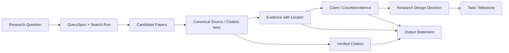
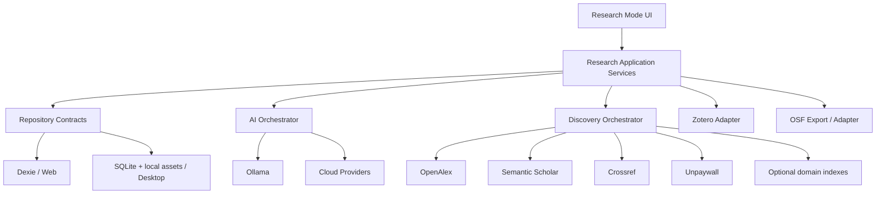

# StudyKit v0.4 Research Mode：AI-native 学术研究工作台

> 版本：0.4.0-draft  
> 日期：2026-07-19  
> 文档性质：公开证据调研 + 产品策略 + 端到端实现方案  
> 目标用户：高年级本科生、硕博生、早期研究者  
> 产品边界：个人研究工作台优先；不在首期替代学术数据库、统计软件、实验平台或成熟文字处理器

---

## 0. Executive Read

Research Mode 可以打通 AI 文献搜索、整理与存储、头脑风暴、研究设计、项目管理和 citations，但它不应该成为七个工具的简单拼盘。真正需要统一的是一条可追踪的研究链：**为什么找到这篇文献、哪段原文成为了什么证据、证据如何支持或反驳论点、论点如何影响研究设计、研究决策如何产生任务、最终文字引用了什么。**

公开用户反馈反复出现的不是“没有 AI 摘要”，而是研究栈碎裂：搜索在 Scholar/Scopus，资料在 Zotero，综合在表格/Obsidian，AI 在 NotebookLM/Elicit，任务在 Notion/Trello，写作在 Word/Docs/Overleaf。用户需要重复下载、上传、复制、找回 citation，并且难以从写作中的一句话回到最初证据。这个信号在社区讨论中很强，但仍属于公开样本，不能替代 StudyKit 自己的用户访谈。[PhD workflow discussion](https://www.reddit.com/r/PhdProductivity/comments/1l9mrwr/whats_your_full_literature_review_workflow/)、[Zotero + Obsidian setup friction](https://www.reddit.com/r/PhdProductivity/comments/1tkhqkr/lets_actually_talk_about_research_workflows/)

现有产品分别把某一段做得很好：Elicit 强在 search/screen/extract，ResearchRabbit/Litmaps/Connected Papers 强在 citation graph discovery，Zotero 强在本地文献库、PDF annotation 和正式 citation，NotebookLM 强在 source-grounded 问答，OSF 强在研究项目、文件和 registration。StudyKit 不应在第一版全面复制这些能力，而应成为它们之间的 **evidence and decision layer**。

最有产品杠杆的首条纵向路径不是“一键完成论文”，而是：

```text
Research Question
→ 可复现搜索
→ 候选文献筛选
→ 本地/外部文献库
→ 带原文定位的 Evidence
→ Claim / Counterevidence
→ Research Design Decision
→ Next Action
→ Evidence-backed Output + verified Citation
```

## 1. 调研范围与证据边界

### 1.1 本轮扫描

- 研究者公开工作流与痛点：Reddit 的 PhD、academic、Zotero、Obsidian 社区；
- 产品能力：Elicit、ResearchRabbit、Connected Papers、Litmaps、scite、NotebookLM、Zotero、OSF；
- 开放学术基础设施：OpenAlex、Semantic Scholar、Crossref、Unpaywall、CSL；
- StudyKit 当前实现：Literature projects/papers、PDF reader、annotation、AI extraction/chat、Canvas、Zotero connector、citation items 与 exports。

### 1.2 证据等级

| 等级 | 定义 | 本文使用方式 |
|---|---|---|
| A | 官方 API/产品文档、同行评议研究 | 判断可实现能力、约束与已知风险 |
| B | 多个独立用户讨论中重复出现的工作流 | 形成待验证需求假设 |
| C | 单个评论、单个 feature request | 作为机会线索，不判断频率 |
| D | 本文产品推断 | 明确标注，并进入用户测试 |

本轮没有 StudyKit 用户访谈、行为日志或付费意愿数据，因此所有优先级仍需通过真实任务验证。

## 2. 排名后的用户问题

### R1：Research stack 断裂，信息反复搬运

- 用户目标：一次保存后，在阅读、综合、计划和写作中持续使用；
- 表面：Scholar/Scopus → PDF → NotebookLM → Zotero → Obsidian/表格 → Word/Docs；
- 破损点：重新下载上传、metadata 重复、annotation 无法跨工具、AI 结果与 citation 脱节；
- 严重度：高；频率信号：高；信心：高；
- 产品动作：建立 canonical Paper/Source identity 和 Zotero interoperability，所有下游对象只引用同一 Source。

Zotero 官方已经支持 PDF annotation 添加到 note 时保留 page link 和 citation，也支持 Word、LibreOffice、Google Docs 引用；这证明 source locator 与正式 citation 应连接，而不是由 AI 重新生成书目信息。[Zotero PDF Reader](https://www.zotero.org/support/pdf_reader)、[Zotero Web API](https://www.zotero.org/support/dev/web_api/v3/basics)

### R2：收藏越来越多，但没有变成可论证的知识

- 用户目标：知道每篇论文对研究问题贡献了什么，以及不同论文如何互相支持或冲突；
- 表面：Zotero collections、tags、PDF highlights、paper notes；
- 破损点：library 变成未读 PDF graveyard；paper-level summary 不能替代 claim/evidence synthesis；
- 严重度：高；频率信号：高；信心：高；
- 产品动作：Evidence、Claim、Counterevidence、Question 成为正式对象；Paper 只是来源，不是综合单位。

用户对自定义研究字段、从 annotations 导出“研究问题/方法/结果”等结构化表格的需求，也说明 bibliographic metadata 不足以承载综合工作。[Zotero custom fields request](https://forums.zotero.org/discussion/131095/feature-request-custom-user-defined-fields-for-zotero-items-in-the-ai-era)、[annotation export request](https://forums.zotero.org/discussion/129088/export-the-annotations-for-my-literature-review)

### R3：搜索结果多，但相关性、覆盖面与选择理由不透明

- 用户目标：从问题出发找到核心、相邻、反例和最新研究，并能解释搜索过程；
- 表面：keyword search、semantic search、citation graph、AI answer；
- 破损点：结果排序像黑箱，关键词偏窄，citation count 偏向旧论文，AI 容易给“看起来合理”的来源；
- 严重度：高；频率信号：中高；信心：高；
- 产品动作：Hybrid Discovery，将自然语言问题转换为可编辑 QuerySpec，同时显示 lexical、semantic、citation-neighbor 和 recency 的命中原因。

ResearchRabbit、Litmaps 和 Connected Papers 已验证 citation graph / seed paper discovery 的价值；Elicit 已把 search、screen、structured extraction 连成工作流。[ResearchRabbit](https://www.researchrabbit.ai/features)、[Litmaps](https://www.litmaps.com/features)、[Connected Papers](https://www.connectedpapers.com/about)、[Elicit systematic review](https://pro.elicit.com/solutions/systematic-reviews)

### R4：AI 摘要提高速度，但可能绕过理解和证据核验

- 用户目标：减少机械劳动，同时保留对研究内容的判断；
- 表面：paper chat、batch summary、literature report；
- 破损点：summary 失去条件和限定，跨论文 synthesis 混合来源，用户无法快速回到原文；
- 严重度：高；频率信号：高；信心：高；
- 产品动作：AI 只能提出 candidate extraction；每条 Evidence 要有 locator、quote hash、来源和 review status。

生成模型直接给 bibliography 风险很高。一项跨主题实验记录了大量 fabricated citations 和真实引用中的字段错误；因此 StudyKit 不能允许模型创建“自由文本 citation”。[Fabrication and errors in bibliographic citations generated by ChatGPT](https://pmc.ncbi.nlm.nih.gov/articles/PMC10484980/)

### R5：头脑风暴与证据分开，想法很快失去依据

- 用户目标：自由发散，同时知道哪些想法来自证据、哪些是猜测、哪些需要验证；
- 表面：白板、Obsidian graph、纸笔、Chat；
- 破损点：paper graph 显示“论文相关”，却不显示“哪条发现支持哪个想法”；通用画布又缺少研究语义；
- 严重度：中高；频率信号：中；信心：中；
- 产品动作：Research Canvas 以 Question、Claim、Evidence、Counterevidence、Method、Decision 和 Task 为角色，并允许 unsourced Idea 明确存在。

### R6：研究设计与执行脱节

- 用户目标：把研究问题转成可执行、可审查、可版本化的设计；
- 表面：proposal、protocol、meeting notes、spreadsheet、task manager、OSF；
- 破损点：设计理由散落在会议和草稿中；变量、样本、分析与任务没有关系；设计变更缺少 decision trail；
- 严重度：高；频率信号：中；信心：中；
- 产品动作：Research Design 不是 AI 生成一段 methodology，而是结构化 Design Spec + Decisions + Risks + Tasks；可导出 preregistration，但不在首期替代统计/伦理审查。

OSF 把项目、文件、components、logs 和 registrations 放在同一体系，并支持永久、带时间戳的 registration。这说明 StudyKit 应支持 design snapshot 与 OSF handoff，而非自建公开注册平台。[OSF API](https://developer.osf.io/)、[OSF Projects](https://help.osf.io/article/353-welcome-to-projects)

### R7：项目管理工具知道任务，却不知道研究依赖

- 用户目标：清楚“为什么这是下一步”以及任务被什么证据或决策阻塞；
- 表面：Notion/Trello、日历、weekly plan、meeting notes；
- 破损点：通用 task 与 research question、paper、analysis decision、supervisor feedback 分离；旧任务埋在长文档中；
- 严重度：中高；频率信号：中高；信心：中；
- 产品动作：Task 必须能链接 Gap、Decision、Source、Output 或 Milestone；默认提供 Weekly Research Review，而非通用企业项目管理。

公开讨论反复提到长期项目缺少结构、会议决定与任务脱节，以及将 literature、chapters、tasks、meeting notes 分散成多套数据库。[PhD research workflow](https://www.reddit.com/r/PhD/comments/1t41yhs/disorganized_research_workflow_how_did_you_fix_it/)、[tracking everything during a PhD](https://www.reddit.com/r/PhD/comments/1s7i68f/whats_your_system_for_keeping_track_of_everything/)

### R8：写作中的 citation 可能存在，但并不真正支持句子

- 用户目标：引用真实、字段正确、未撤稿，而且确实支持当前陈述；
- 表面：citation picker、bibliography、AI citation suggestion；
- 破损点：引用存在性、metadata、support relation 与格式是四件不同的事；
- 严重度：极高；频率信号：中；信心：高；
- 产品动作：Citation Audit 分四层检查：Identity、Metadata、Integrity、Entailment。格式化使用 CSL，不让 LLM 模仿 APA 文本。

Crossref REST API 可以核验 DOI metadata，并已提供 Retraction Watch 数据；CSL 是开放的 citation/bibliography 格式规则。[Crossref REST](https://www.crossref.org/documentation/retrieve-metadata/rest-api/access-and-authentication/)、[Retraction Watch in Crossref](https://www.crossref.org/documentation/retrieve-metadata/retraction-watch/)、[CSL](https://docs.citationstyles.org/en/master/primer.html)

## 3. 竞争格局：StudyKit 不该逐项复制

| 阶段 | 强产品 | 已解决 | 仍然断裂的部分 |
|---|---|---|---|
| Academic search | Google Scholar、Semantic Scholar、Consensus、Elicit | 大规模检索、问答、排序 | 与用户本地 evidence、design 和 tasks 不连续 |
| Citation exploration | ResearchRabbit、Litmaps、Connected Papers | seed graph、prior/derivative work、alerts | graph 多在 paper level，不表达用户的 claim/evidence |
| Screening/extraction | Elicit | criteria、tables、supporting quotes | 通用研究项目设计和长期个人知识较弱 |
| Source-grounded AI | NotebookLM | uploaded source Q&A、inline citations | 正式 reference management 与学术 citation 输出仍有断层 |
| Citation context | scite | citation statements、supporting/contrasting context | 商业数据依赖，不能作为本地核心真相源 |
| Reference management | Zotero | capture、metadata、PDF、annotation、CSL、word processors | 跨论文综合、研究设计和项目决策不是核心 |
| Research lifecycle | OSF | project files、components、registration、public/private | 日常阅读、evidence synthesis 和 AI-native interaction 不是核心 |
| Knowledge / PM | Obsidian、Notion、Trello | 灵活 notes、links、tasks | setup 成本高，source provenance 和 citation 需插件拼装 |

### StudyKit 的差异化

**不是拥有最多论文，也不是生成最长报告，而是让 research intent、source、evidence、claim、decision、task、output 和 citation 保持同一条 lineage。**

## 4. 产品模型：Research Graph + Multiple Workspaces

### 4.1 一条可追踪研究链



### 4.2 两种研究严格度

用户建立 Project 时选择的是工作方式，不是学科标签：

- **Explore**：发现、阅读、综合、形成问题；允许迭代搜索和灵活字段；
- **Review / Protocol**：保存完整 search runs、criteria、include/exclude reasons、duplicates 和 design snapshot；
- **Empirical Study**：以 Research Design、data/analysis milestones 和 decision log 为主；
- **Thesis / Dissertation**：同时包含 literature、design、meetings、chapters 和 milestones。

同一对象模型支持四类 project，界面渐进披露不同视图，避免每个用户一上来看到 systematic review 的全部复杂度。

Project type 不是永久流程锁。用户可以先以空白 Explore 项目开始，之后只启用需要的 Screening、Design、Timeline、Review 或 Collaboration 视图；系统不因缺少 Research Question、Evidence 类型或 protocol 字段而阻止自由探索。

## 5. 端到端产品方案

### 5.1 Project Home：研究状态而非文件首页

首页回答五个问题：

1. 我当前的 Research Question / objective 是什么？
2. 证据覆盖到哪里，最大的冲突和 gap 是什么？
3. 最近做了哪些 research decisions？
4. 下一步最小行动是什么，为什么？
5. 哪些 milestone、meeting 或 output 临近？

首页模块：Current Question、Evidence Coverage、Open Gaps、Recent Decisions、Next Actions、Outputs、Saved Searches/Alerts。

### 5.2 AI-native Literature Discovery

#### QuerySpec

用户输入自然语言问题后，AI 先生成可编辑结构，不直接显示“最终答案”：

```ts
type QuerySpec = {
  question: string;
  concepts: Array<{ label: string; synonyms: string[] }>;
  includeTerms: string[];
  excludeTerms: string[];
  population?: string[];
  interventionOrExposure?: string[];
  outcomes?: string[];
  studyTypes?: string[];
  dateRange?: { from?: number; to?: number };
  languages?: string[];
  seedPaperIds: string[];
  strategy: 'explore' | 'balanced' | 'precise' | 'review';
};
```

用户可以看到 AI 扩展的同义词和排除词。每次运行保存 provider、query、filters、时间、结果 IDs 和版本，支持“为什么出现这篇”与复现。

#### Hybrid Discovery

候选集合来自四路：

1. lexical metadata / abstract search；
2. semantic similarity；
3. references / citations / related seed graph；
4. saved search 的新论文与 counterevidence query。

排序显示可解释 reason chips：`matches construct`、`cites seed`、`recent review`、`contradicts accepted claim`。citation count 只是一个 signal，不是默认质量分。

#### Provider 架构

| Provider | 用途 | 产品角色 |
|---|---|---|
| OpenAlex | 广覆盖 metadata、topics、citation graph | 默认开放索引，数据 CC0 |
| Semantic Scholar | relevance search、recommendations、citations、SPECTER2 | semantic/seed 增强，受 rate limit 约束 |
| Crossref | DOI metadata、publisher records、updates/retractions | canonical metadata 与 integrity |
| Unpaywall | 合法 OA locations | 获取可下载全文，不绕过 paywall |
| Zotero local/web API | 用户既有 library、collections、attachments | interoperability 与 citation library |
| PubMed / Europe PMC / arXiv | 学科 adapter | 按项目类型启用 |
| Elicit / scite | 商业增强 | 可选 connector，不作为核心依赖 |

OpenAlex 提供开放 scholarly catalog；Semantic Scholar 提供 papers、citations、recommendations 与 embeddings；Unpaywall 提供开放获取位置。[OpenAlex API](https://developers.openalex.org/api-reference/introduction)、[Semantic Scholar API](https://www.semanticscholar.org/product/api)、[Unpaywall API](https://data.unpaywall.org/products/api)

#### Screening

- 快捷状态：Unscreened、Maybe、Include、Exclude；
- Exclude 必须可选理由，Review 模式要求填写；
- AI 只给 recommendation + supporting abstract/full-text quote + confidence；
- 批量动作先预览，保留人工 override；
- DOI、PMID、arXiv ID、规范化 title/author/year 去重；
- 未获得全文的论文可以保留 metadata 状态，但 AI 不假装分析过全文。

### 5.3 Library & Storage

#### Canonical identity

一个学术作品只有一个 `Source/CitationItem`，不同 provider IDs 和多个 PDF version 都挂在其下：

```text
Work
├── identifiers: DOI / PMID / arXiv / OpenAlex / S2 / Zotero key
├── canonical metadata + field-level provenance
├── versions: submitted / accepted / published
├── assets: local PDF / OA URL / linked file
├── annotations / locators
└── memberships: projects / collections / reading states
```

- metadata 合并按字段记录 provider 和更新时间；
- DOI 冲突、title mismatch 和 retraction 不静默处理；
- 默认复制用户导入 PDF 到本地 workspace；Zotero 可选择 link/import；
- 付费全文只能由用户上传、机构授权 connector 或合法 OA location 获得；
- Search result 不是 Library item，用户保存或 AI workflow 明确确认后才入库。

### 5.4 Reader → Evidence

Reader 默认是 PDF/HTML 左侧、Research Notes/Evidence 右侧：

- 框选后动作：Save as Evidence、Candidate Claim、Method Detail、Limitation、Question、Quote；
- 保存 Evidence 时同时记录 source locator、exact quote、用户 paraphrase、evidence type 与 relevance；
- AI 可以预填字段，但初始状态为 `candidate`；
- 用户确认后成为 `verified`；
- Paper summary 独立存在，不能直接作为 Evidence；
- 从任何 Evidence 一步回到原页和 bounding boxes。

```ts
type Evidence = {
  id: string;
  sourceId: string;
  locator: SourceLocator;
  exactQuote?: string;
  userInterpretation: string;
  evidenceType: 'finding' | 'method' | 'definition' | 'theory' | 'limitation' | 'context';
  status: 'candidate' | 'verified' | 'rejected';
  relevanceToQuestionIds: string[];
  extractionRunId?: string;
};
```

### 5.5 Evidence Table 与 Synthesis

用户按研究问题选择 comparison schema，例如：Study Design、Sample、Context、Construct、Measure、Effect、Limitation。AI 可以建议字段和抽取 candidate cells；每个 cell 都能打开 supporting passage。

关键区别：

- **Paper row**：一篇论文；
- **Evidence row**：论文中的一条可定位证据；
- **Claim row**：用户对多条 Evidence 的判断；
- **Synthesis view**：这些对象的 query，不再复制内容。

### 5.6 Research Canvas 与头脑风暴

Canvas 支持两个明确阶段：

#### Diverge

- 快速创建 Idea、Question、Hypothesis 和 Assumption；
- AI 提供 alternative explanation、opposite view、missing stakeholder、boundary condition；
- 无来源想法清楚显示 `unsourced`，这不是错误；
- 用户可以把一个 Idea 变成 Search Query 或 Task。

#### Converge

- 把 Evidence 拖到 Claim，明确 `supports / contradicts / qualifies`；
- AI 建议 cluster、重复项、反例和 gap，但必须预览；
- paper citation graph 作为一个可开关 background layer，不冒充用户论证；
- Claim 显示 evidence coverage、conflict 与 confidence，不显示虚假的“AI truth score”。

### 5.7 Research Design Workspace

Research Design 采用结构化 spec，而不是一段 AI methodology：

```text
Research Question
├── Rationale / gap
├── Hypotheses or objectives
├── Constructs and operational definitions
├── Design type
├── Population / sample / recruitment
├── Variables / measures / materials
├── Procedure
├── Data and analysis plan
├── Ethics / privacy / consent
├── Risks / assumptions / alternatives
└── Deviations and decisions
```

用户需要时可打开 Method Assistant：

- 追问 RQ 与 design 是否对齐；
- 指出 construct 没有 operational definition；
- 检查 outcome、sample、analysis 之间的缺口；
- 从 verified method evidence 提供候选做法；
- 生成 checklist 和需要咨询导师/统计师/伦理委员会的问题；
- 不能宣称设计“有效”或自动给伦理批准；
- 涉及 power、statistical test 或 causal identification 时，建议进入专用工具，并保存输入/输出链接。

首发提供通用模板 + social/behavioral quantitative reference profile。其他学科通过 template/profile 扩展，避免通用 AI 假装掌握所有研究方法。

#### Versioned decisions

每次关键修改创建 Design Decision：

```text
Decision: 将主要 outcome 从 X 改为 Y
Reason: pilot reliability + supervisor feedback
Evidence: E-12, E-27
Impact: sample plan, analysis plan, preregistration
Tasks created: update measure, rerun power analysis
```

设计成熟后可导出 OSF preregistration draft 或 snapshot；正式 registration 仍由用户在 OSF 确认。

### 5.8 Research-native Project Management

StudyKit 不先做通用甘特图。首发只做研究语义：

- Milestone：proposal、pilot、ethics、data collection、analysis、chapter draft、submission；
- Task：链接 Gap、Decision、Source、Dataset 或 Output；
- Blocker：waiting for data / supervisor / ethics / access / analysis；
- Meeting：agenda、notes、decisions、tasks；
- Weekly Review：progress、new evidence、changed assumptions、next three actions；
- Activity log：search、screening、design changes、AI drafts 与 exports。

AI Project Assistant 可以从 decision/gap 建议 task、检测阻塞依赖、整理 meeting follow-up、给出下一个最小行动。所有建议可忽略或关闭；它不根据“论文数量”评价进度，也不替团队分配工作。

### 5.9 Output 与 Citations

#### Evidence-backed writing

Output Editor 支持 Outline → Section → Statement：

- Statement 可以链接 Claim、Evidence 和 CitationItem；
- AI 只基于用户选择的 Claim/Evidence 起草段落；
- 生成段落逐句显示 supporting objects；
- 无支持句标记为 `unsupported`；
- 用户可以把 Word/Docs/LaTeX 当最终编辑器，StudyKit 首期专注结构化 outline 与可引用 Markdown/DOCX export。

#### Citation pipeline

```text
Citation suggestion
→ resolve to canonical Work
→ DOI/identifier verification
→ metadata reconciliation
→ retraction/correction check
→ evidence entailment review
→ insert cite key
→ render with CSL
```

AI 不能输出一个不存在于 canonical library/search results 中的 reference。找不到匹配记录时，只能创建 `citation needed` task。

#### Interoperability

- Zotero：优先支持 read/import，之后提供明确的 manual two-way sync；
- Citation formats：CSL-JSON 为内部交换格式，支持 BibTeX/BibLaTeX/RIS；
- Render：citeproc-js / compatible CSL processor；
- Export：Markdown + citekeys、DOCX-friendly、LaTeX/Quarto；
- Word/Google Docs live Zotero fields 属于独立技术 spike，不在没有验证的情况下承诺无损 round-trip。

### 5.10 Research Collaboration

Research 项目天然包含共同阅读、讨论、设计决策、任务交接和共同写作。协作不是把所有人同时放到一张画布，而是同时支持实时共创与异步审阅。

#### 成员与空间

- 角色：Owner、Editor、Commenter、Viewer；权限可按 Project，后续再验证是否需要 component-level 权限；
- Shared Layer：正式 Sources、Evidence、Claims、Design、Tasks、Outputs；
- Private Scratch：个人临时笔记、自由画布和 AI drafts，默认只有本人可见；
- Publish to project：将个人内容以明确 diff 发布到共享层，不自动暴露思考草稿；
- Guest review：导师或合作者可以只评论、resolve 或 approve，不必学习完整工作台。

#### 同步与异步协作

- Canvas 与 collaborative text：presence、光标、选区、实时编辑和断线恢复；
- Sources、Evidence、Claims：对象级 comments、mentions、assign、review status；
- Design Decisions：proposal → discussion → accepted/superseded，并保留理由；
- Tasks/Milestones：负责人、依赖、blocker、完成证据；
- Meetings：共享 agenda、notes、decisions 和自动生成但需确认的 follow-ups；
- Activity：谁在何时修改、接受了哪个 AI draft、改变了什么 citation 或设计。

Zotero Groups 已验证研究团队需要私有/公开 group libraries、成员角色与共享文件；OSF 也提供 Read、Read+Write、Admin 权限和项目 activity。StudyKit 应复用这些简单心智模型，而不是首期设计复杂企业权限。[Zotero Groups](https://www.zotero.org/support/groups)、[OSF contributor permissions](https://help.osf.io/article/246-understand-contributor-permissions)

#### 团队中的 AI

- AI run 属于发起者，在发布前保持 private draft；
- 发布结果时显示 source scope、provider、model、cost owner 和发起人；
- AI 不代表团队成员发言，不自动 resolve comment 或 approve decision；
- 共享项目可以限制允许的 provider、外发数据范围和预算；
- 一个成员的个人 AI 偏好不改变其他成员界面；
- 团队可以复用 QuerySpec、extraction schema 和 prompts，但每次运行仍有独立 provenance。

## 6. AI-native Agent Model

不要创建七个拟人 chatbot。使用同一个 AI Orchestrator，根据动作加载不同 capability 与 context policy：

这些 capability 不分别占据页面。它们都通过同一个系统级 AI Assistant 被召唤：用户在论文、Evidence、Claim、Canvas、Task 或 Output 上发起动作，Assistant 根据当前 Context Packet 选择 capability，并把结果返回原对象附近或 Draft Layer。复杂任务可以展开为临时 workspace，但结束后必须回到研究 lineage。

| Capability | 输入范围 | 产出 | 必须人工确认 |
|---|---|---|---|
| Query Builder | RQ + selected seeds | QuerySpec draft | terms、filters、run |
| Scout | QuerySpec + indexes | candidate papers + reasons | save/include |
| Extractor | selected full text | candidate Evidence/fields | locator、meaning |
| Synthesizer | verified Evidence | themes/comparison draft | Claim 与关系 |
| Critic | selected Claims | counterevidence/gaps/questions | judgment |
| Method Assistant | Design Spec + evidence | consistency checks/options | design decisions |
| Project Assistant | decisions/gaps/tasks | next actions/dependencies | priority/dates |
| Citation Auditor | statements + works | identity/integrity/support flags | final citation |

### 6.1 Background runs

AI 可以后台执行 search、metadata enrichment、OCR、dedup、extraction 和 citation integrity checks，但每个 Run 必须具有：

- plan、provider、scope、cost estimate；
- progress、pause、cancel、retry；
- inputs snapshot 与 output drafts；
- partial failure；
- 不可自动 commit 正式对象。

### 6.2 Context policy

- Discovery 只需要 RQ、QuerySpec 和 seed metadata，不发送整个 workspace；
- Extractor 只读取用户选择的全文/页；
- Synthesizer 默认只读取 verified Evidence，不直接吞所有 PDF；
- Method Assistant 读取 Design Spec、相关 Evidence 和用户选择的 guideline；
- Citation Auditor 不允许根据模型记忆补 reference；
- 云 provider 显示发送范围；本地 Ollama 可作为隐私选项，但不能降低 citation verification 标准。

## 7. 对当前 StudyKit 的差距诊断

### 7.1 可以复用

- `literature_projects`、PDF upload/reader、paper annotations；
- Summary Table 与 custom extraction fields 的交互基础；
- Zotero account、collection、item import 和 connector event；
- `citation_items` 的 CSL/BibTeX 基础；
- AI provider profiles、Ollama/custom/cloud adapters；
- Literature Canvas、paper/node/edge 和 scene 能力；
- Paper relations 与 Markdown export 的部分基础。

### 7.2 必须重构

| 当前状态 | 问题 | v0.4 目标 |
|---|---|---|
| `literature_projects` 只有 name/description | 无 RQ、stage、design、milestone | Research Project domain |
| `literature_papers` 与 `citation_items` 并存 | canonical identity 模糊、重复 metadata | Work/Source 为真相，assets/IDs 挂载 |
| `extracted_data JSONB` | 一次覆盖、无字段 provenance/review | versioned candidate extractions |
| AIChatPanel 为主要交互 | 用户重新提问，上下文和动作不结构化 | contextual actions + Context Packet |
| AI extraction 直接 PATCH paper | 未进入 Draft Layer | candidate → reviewed → accepted |
| `paper_notes` 只有自由文本 | 无 locator、Evidence 类型或状态 | Evidence/Claim/Question objects |
| `paper_relations` 只连接 paper | paper graph ≠ argument graph | object relations |
| Canvas node 保存 content_json | 正文与 view 容易重复 | object content 与 placement 分离 |
| 没有 search run / screening | 无可复现发现过程 | QuerySpec、Run、Candidate、Decision |
| 没有 design/task/output domain | 研究生命周期中断 | Design Spec、Decision、Task、Output |
| citation 主要用于导出 | 没有 integrity/entailment audit | verified citation pipeline |
| 没有 project membership/comment/review domain | 无法表达研究团队、私有草稿和共同决策 | Collaboration domain + Private/Shared layers |

### 7.3 重要技术风险

- 当前 backend route 默认认证，与“本地无需账号”方向冲突；需通过 repository/platform adapter 落地；
- provider metadata 不一致，必须做 field-level provenance 和 dedup；
- PDF full text/locator 质量会直接限制 Evidence 和 citation support；
- Semantic Scholar 等服务有 rate limits，不能把单一第三方当可用性前提；
- Zotero two-way sync 容易产生 version conflict，首期应 read/import 优先；
- 实时协作与离线本地编辑同时存在时，单纯 last-write-wins 会丢失画布和文本修改；需要 CRDT/operation log spike；
- 自动抓取 paywalled PDF 有版权与授权风险，只使用 OA、用户导入或机构授权渠道；
- 学科方法差异巨大，Research Design 必须 profile 化。

## 8. 数据模型增量

在 v0.4 统一 `objects / relations / sources / views` 模型上增加以下 Research records：

```text
research_projects
research_questions
query_specs
search_runs
search_candidates
screening_decisions
works
work_identifiers
source_assets
source_locators
evidence_objects
claims
research_design_specs
research_decisions
milestones
research_tasks
meetings
outputs
output_statements
citation_mentions
ai_runs
ai_drafts
provenance_records
project_memberships
object_comments
mentions
review_requests
collaboration_documents
collaboration_updates
```

首期不必物理建 20 张表。Question、Evidence、Claim、Decision、Task 和 Output 可以继续使用通用 `objects` 表，以 subtype payload 表达；Search Run、Work identity、Design Spec、AI Run 等有强事务与查询需求的记录单独建表。

### 8.1 Canonical Work identity

```ts
type WorkIdentity = {
  id: string;
  identifiers: {
    doi?: string;
    pmid?: string;
    arxiv?: string;
    openAlex?: string;
    semanticScholar?: string;
    zotero?: string;
  };
  canonicalMetadata: CSLItem;
  metadataProvenance: Record<string, MetadataSource>;
  integrity: {
    status: 'unknown' | 'ok' | 'corrected' | 'retracted' | 'concern';
    checkedAt?: string;
    sources: string[];
  };
};
```

### 8.2 Search record

```ts
type SearchRun = {
  id: string;
  projectId: string;
  querySpecVersion: string;
  providerRequests: ProviderRequestSnapshot[];
  resultWorkIds: string[];
  startedAt: string;
  completedAt?: string;
  status: 'running' | 'partial' | 'completed' | 'failed';
  errors: ProviderError[];
};
```

## 9. 实现架构



### 9.1 服务边界

- `DiscoveryService`：QuerySpec、fan-out、rate limit、dedup、ranking reasons；
- `WorkResolver`：DOI/IDs、metadata merge、version、integrity；
- `FullTextResolver`：local asset、OA location、user/connector authorization；
- `EvidenceService`：locator、candidate extraction、verification；
- `SynthesisService`：comparison、claims、counterevidence、coverage；
- `ResearchDesignService`：spec、decision、snapshot、profile validation；
- `ResearchPlanningService`：milestone、task、meeting、dependency；
- `CitationService`：CSL、citekeys、integrity、mentions、exports；
- `CollaborationService`：memberships、roles、comments、mentions、reviews、presence、shared/private publish；
- `ResearchAIOrchestrator`：Context Packet、provider capability、draft、provenance。

### 9.2 Search ranking

首期采用可解释加权，而非训练自有 ranking model：

```text
score = lexical relevance
      + semantic similarity
      + seed graph proximity
      + explicit study-type fit
      + recency signal
      + user include/exclude feedback
```

用户可以切换 Explore / Balanced / Precise。系统保存每个分量和 provider 原始 rank，便于调试偏差。

### 9.3 Citation verification

四层状态分别显示，不能折叠成一个绿色勾：

1. `identityVerified`：DOI/identifier 指向真实 Work；
2. `metadataVerified`：作者、标题、年份、venue 已与 registry 对齐；
3. `integrityChecked`：retraction/correction/concern 已查询；
4. `supportReviewed`：用户确认该来源支持当前 Statement。

## 10. 分阶段交付

### R0：Research foundation（2 周）

- canonical Work/Source identity；
- Evidence、Claim、Question、Task 通用对象；
- source locator 与 Draft Layer；
- 将现有 extracted_data 改为只读 legacy + versioned candidate path；
- 当前 Zotero、PDF、AI provider 通过 adapter 接入。

**Gate**：一条 Evidence 能从 Table/Canvas/Output 回到同一 PDF locator。

### R1：Discovery → Library（3 周）

- QuerySpec editor；
- OpenAlex + Crossref + Unpaywall；
- Semantic Scholar seed/recommendation adapter；
- dedup、ranking reasons、saved run；
- screening 与 include/exclude；
- 保存到本地 library / Zotero import mapping。

**Gate**：用户能解释搜索词、结果来源和保存理由；重复 Work 不超过测试门槛。

### R2：Reader → Evidence → Claim（3–4 周）

- contextual selection actions；
- candidate extraction + review；
- Evidence Table 与 comparison schema；
- Claim / Counterevidence 关系；
- AI Critic 与 gap detection。

**Gate**：从三篇论文形成一个带支持、限制和原文定位的 Claim。

### R3：Research Canvas（2–3 周）

- divergence/convergence；
- object-based nodes；
- argument relations；
- paper citation background layer；
- AI clustering/layout preview。

**Gate**：Canvas 改善 synthesis task，不增加 capture time。

### R4：Design + Project Management + Collaboration（4–5 周）

- Design Spec、templates/profile；
- decision log、risks、deviations；
- milestone/task/meeting/weekly review；
- Method Assistant 与 next-action suggestions；
- project roles、comments、mentions、shared tasks 和 activity log；
- Private Scratch → Shared Layer publish flow；
- Canvas presence 与实时协作技术 spike；
- OSF preregistration draft export。

**Gate**：一项 design change 能显示 evidence、影响、讨论与后续 tasks；离线重连不丢共同编辑内容。

### R5：Output + Citation Audit（3 周）

- evidence-backed outline/statements；
- canonical citation insertion；
- CSL render、BibTeX/RIS/CSL-JSON export；
- Crossref metadata/integrity checks；
- unsupported / citation-needed audit；
- Word/Docs/LaTeX handoff spike。

**Gate**：任一句研究陈述能回到 Claim、Evidence、原文和 verified Work。

## 11. MVP 与范围控制

### 首个可验证 MVP

**Research Question → Search Run → Save 3 Papers → Verify 5 Evidence → Create Claim + Counterevidence → Export cited outline。**

MVP 必须有：

- OpenAlex/Crossref/Unpaywall discovery；
- Zotero/local import；
- PDF locator；
- Evidence/Claim；
- Contextual AI drafts；
- CSL citations；
- local desktop data path；
- collaboration-ready ownership、object comments 和 activity schema。

MVP 不需要：

- 自动完整 systematic review；
- 通用 gantt/resource planning；
- AI 自动选定研究方法；
- 内置统计执行环境；
- 所有学科的 protocol template；
- 第一条 evidence-loop 原型中的复杂实时多人文档编辑；
- 无损编辑复杂 Word 文档；
- 自建全量 scholarly index。

## 12. 指标

### Discovery

- time to first relevant saved paper；
- result → screened → included 转化；
- duplicate rate；
- 用户能否解释 QuerySpec 和 result reason；
- known-item recall / benchmark query coverage。

### Evidence

- verified Evidence 有有效 locator 的比例；
- candidate extraction 的人工修订率；
- 从 saved paper 到 first Evidence 的时间；
- Claim 同时有 support 与 counter/qualification 的比例。

### Design / PM

- Design Decision 链接 evidence/reason 的比例；
- decision 产生 next task 的比例；
- weekly active projects 有明确 next action 的比例；
- blocker aging 与 milestone predictability。

### Citation

- identifier/metadata/integrity check pass rate；
- fabricated reference count，目标 0；
- unsupported statement rate；
- Output → source locator 回跳成功率；
- citation export 后人工修复时间。

### Collaboration

- comment / mention 到 resolution 的时间；
- Design Decision 有明确讨论与决策人的比例；
- shared task 能回到 Evidence/Gap/Decision 的比例；
- reconnect 后未合并或丢失编辑数，目标为 0；
- 用户误把 Private Scratch 发布到 Shared Layer 的事件数，目标为 0。

## 13. 需要真实用户验证的决策

1. 首批用户更需要 Explore，还是 systematic Review；
2. 是否接受 canonical library 与 Zotero 双向关系，还是坚持 Zotero 为唯一文献真相源；
3. Evidence verification 的摩擦是否可接受；
4. Research Canvas 的主要价值是 argument map、literature landscape 还是 design brainstorming；
5. 第一批学科是否聚焦心理/社会科学，还是保持通用但更浅；
6. Project Management 应深入到 supervisor meetings 和 chapter planning 的程度；
7. 用户最终在 StudyKit 写作，还是只需要高质量 Word/Docs/LaTeX handoff。

## 14. Opportunity Map

### 现在就做（本周）

- 冻结 Research Question → Evidence → Claim → Citation 的对象与关系定义；
- 给当前 PDF annotation 增加稳定 SourceLocator 设计；
- 停止新增直接覆盖 `extracted_data` 的 AI 功能，后续一律进入 candidate/draft；
- 用 5 个真实研究问题建立 known-paper benchmark，为搜索 provider spike 准备基线；
- 用现有 Zotero 数据验证 `literature_papers` 与 `citation_items` 的重复/冲突类型。

### 本季度做

- 完成 R0–R2：canonical Work、Hybrid Discovery、Screening、Evidence 和 Claim；
- 用 OpenAlex + Crossref + Unpaywall 建立开放基础，Semantic Scholar 作为增强；
- 把 AI 从常驻 Chat 转为 Query Builder、selection extraction、Critic 等上下文动作；
- 完成 Research MVP 的 cited outline export；
- 建立 project roles、comments、mentions、Private/Shared layers 和 Canvas collaboration spike；
- 在桌面本地 workspace 中验证 1,000 papers / 10,000 evidence objects 的性能与恢复。

### 需要更深研究后做

- systematic review 的 protocol、dual screening、PRISMA 与 audit depth；
- 学科特定 Research Design profiles；
- Zotero two-way sync 和 Word/Google Docs live citation round-trip；
- component-level permissions、复杂 approval workflow 与大规模团队管理；
- scite/Elicit 等商业数据连接的成本与用户付费意愿；
- 自动 citation entailment 的准确率、责任边界与可解释性。

## 15. 产品结论

Research Mode 值得做成端到端工作台，但“all-in-one”不应意味着把所有功能放在一个屏幕里。StudyKit 应统一研究对象与来源链，保留不同任务的最佳视图，并把 AI 放在每个交接点：帮用户形成搜索、提取候选证据、发现冲突、检查设计、形成下一步和审计 citation。

最应避免的方向是：搜索后自动摘要几十篇论文、生成一张漂亮知识图，再直接产出带引用的文章。那会优化内容产量，却破坏研究过程中最重要的可追溯判断。
